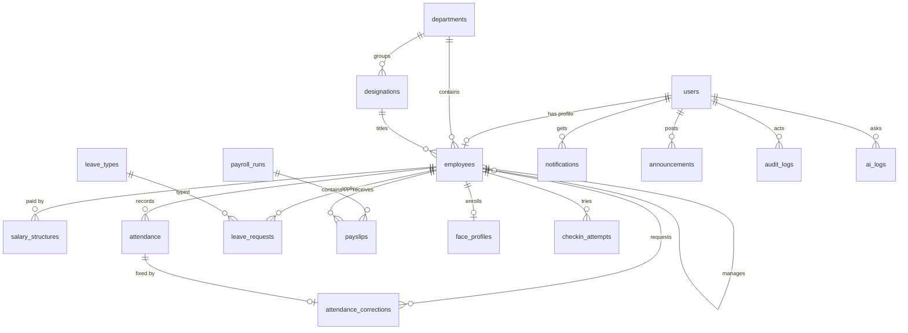

# HCM Lite — Complete Requirements & Build Plan

> Saylani Hackathon · 24 October 2026 · Zaitoon Ashraf IT Park
> Stack: **React (Vite) + Node/Express + Supabase Postgres** · Team: BE1, BE2, FE1, FE2
> Source of truth: *HCM Lite — Challenge Brief* (Sections 1–9). Every rule, number and permission in the brief is captured below and traced in §16.

---

## As-built notes (changes made during the build)

These decisions replace the matching parts of the plan below. Everything else was built as specified.

| Planned | As built | Why |
|---|---|---|
| Prisma ORM, `schema.prisma` + migrations | Plain SQL schema `server/sql/01_schema.sql` (idempotent) applied by `npm run db:setup`; queries through `pg` | Analytics are raw SQL anyway; avoids Prisma + Supabase pooler issues and a generate step on deploy |
| Postgres enums | `text` columns with `check` constraints | Same safety, simpler upgrades |
| `gemini-2.5-flash` | `gemini-3.5-flash-lite` (fallback `gemini-3.1-flash-lite`), `reasoning_effort=low` | 2.5 is unavailable to new keys; `gemini-3.8-flash` took ~40 s, over the 15 s limit. Flash-lite answers in 2–10 s with correct tool calls |
| openai npm SDK | Direct `fetch` to the OpenAI-compatible endpoint | No extra dependency; same tool-calling format |
| shadcn/ui, react-hook-form, vite-plugin-pwa | Tailwind 4 with a small shared component set (`client/src/ui.jsx`), plain controlled forms, hand-written `public/sw.js` | Faster to build within the time box |
| TypeScript optional | JavaScript (ESM) | Team decision |
| Timeline H0–H11 | 6-hour plan (§14.1) | Confirmed time box |
| Supabase direct host | Session **pooler** host (`aws-0-ap-northeast-1.pooler.supabase.com:5432`) | Direct host is IPv6-only |
| Chat intent shortcut for leave | Extra AI tool `draft_leave_request` (prepares a draft only; never saves) | Lets the model fill dates from the conversation; the user still confirms |
| API tests against a test DB | `server/tests/api.test.js` runs in a throwaway `hcm_test` schema (`DB_SCHEMA`) of the same database | No second database needed; real data never touched |

Additions not in the original plan: Admin **AI logs** page (`/ai-logs`), late % per department and leave utilization tables on the HR dashboard, payroll cost by month and average salary by department on the Admin dashboard, and the `faceMatchRequired` setting with `GET /attendance/face` + `POST /attendance/face/enroll`.

---

## Table of contents

1. Overview, goals, scope, assumptions
2. Tech stack decisions + `.env.example`
3. Roles, permission matrix, data scope
4. Functional requirements (M1–M9)
5. Business rules engine (with worked examples)
6. Database design (Supabase Postgres)
7. Backend design + REST API catalogue
8. AI design (M8)
9. Analytics & dashboards (M7)
10. Frontend design
11. Camera attendance (bonus)
12. Security & non-functional requirements
13. Testing plan
14. Work breakdown & timeline (BE1, BE2, FE1, FE2)
15. Demo script, README outline, submission checklist
16. Traceability matrix
17. Open questions & decisions taken

---

## 1. Overview, goals, scope, assumptions

### 1.1 Product
HCM Lite is a web-based Human Capital Management system for the daily work of an HR team, with **three roles** (Admin, HR, Employee), **9 modules**, **25 functionalities**, and an **AI assistant** that answers only from real database data through scoped tools.

### 1.2 Hard constraints from the brief
| # | Constraint |
|---|---|
| C1 | **No pre-loaded or dummy data.** Fresh install starts empty → first-run setup → Admin sets up company → HR registers employees → every number comes from in-app activity. |
| C2 | Three roles, each with **own menu, data scope and dashboard**. |
| C3 | Access checked **on the server for every request**; hiding buttons is not enough. AI uses the **same access** as the user. |
| C4 | Core flows end to end: employees, web check-in/out, leave with approval, monthly payroll with payslips (PDF). |
| C5 | Analytics computed on the server (DB aggregation), filterable by **date range and department**. |
| C6 | AI: any hosted LLM with **tool calling**; key only in backend env `AI_API_KEY`; browser never calls the AI provider. |
| C7 | Web app required; mobile/camera attendance optional (bonus). |
| C8 | 5-minute live demo; README a judge can run in **< 10 minutes**; hosted link starts at first-run setup. |
| C9 | Commit `.env.example` only; never real secrets. |
| C10 | Responsive from **375 px** width. |

### 1.3 Goals (mapped to scoring)
| Criterion | Pts | Our goal |
|---|---|---|
| Core HR flows | 25 | All 4 core flows work end to end for all 3 roles on the hosted link |
| Data & analytics | 20 | Dashboards = records created during judging; filters work; useful insight lists |
| AI features | 15 | Correct live answers to every judge question; role scoping; smart leave; summaries; graceful failure |
| Code quality | 15 | Module structure, rules in services, zod validation, unit + API tests |
| UI / UX | 10 | Consistent shadcn UI, loading/empty/error states, responsive |
| Security & RBAC | 10 | Server-side role + scope guard, bcrypt, AI key server-only, append-only audit log |
| Demo & docs | 5 | Rehearsed 5-min script, working hosted link, README |
| Bonus | +10 | Camera + geofence check-in, late penalty rule, Roman Urdu, dark mode/PWA, attrition risk, anomaly flags |

### 1.4 Scope
**MUST (core):** M1–M9, all 25 functionalities (§3.1), all business rules (§5), all metrics (§9), AI chat + 7 tools + dashboard summary + smart leave + policy Q&A, guardrails, README, hosting.

**OPTIONAL:** CSV import/export (functionality 08 is in the checklist → we treat it as MUST, the brief calls it "optional" only in M3 text), mobile app.

**BONUS (in priority order):**
1. Dark mode (cheap) + PWA manifest
2. Late penalty rule (3 lates = 0.5 day) as a settings toggle
3. AI understands Roman Urdu (prompt-level)
4. Camera attendance in the **web app** (face detection + geofence) — no separate mobile app
5. Absence anomaly flags
6. Attrition risk score
7. Face match against enrolled descriptor + blink liveness

**OUT OF SCOPE:** email/SMS delivery, multi-company tenancy, multi-currency, shift rosters, overtime, loans, native mobile app (unless time allows).

### 1.5 Assumptions
| ID | Assumption |
|---|---|
| A1 | Single company per install. Timezone **Asia/Karachi (UTC+5, no DST)**; all "today" logic uses this TZ on the server. |
| A2 | Currency **PKR**; amounts stored as `numeric(12,2)`, rounded half-up to 2 dp; net pay displayed to whole rupees. |
| A3 | **Server stamps all times** (`now()` on the server); client never sends check-in/out time (except HR-approved corrections). |
| A4 | Settings (office start, grace, half-day hours, weekend) **apply to new records only** → each attendance record stores a rule snapshot. |
| A5 | Week = Mon–Sun; default weekend Sat–Sun (configurable). |
| A6 | Leave year = calendar year (1 Jan – 31 Dec); quotas not prorated for joiners; no carry-forward. |
| A7 | Tax is computed on **full monthly gross × 12** per the illustrative slab, then ÷ 12, then multiplied by the proration factor for joiners/leavers. |
| A8 | HR users are also employees (they check in, apply for leave, get payslips). Admin users are **not** employees. |
| A9 | No email service: temporary passwords are shown once to the creator in a modal (and in the CSV import result file). |
| A10 | Standard leave types (Annual 14, Sick 8, Casual 10, Unpaid unlimited) are **configuration, not dummy data**: the first-run wizard offers a one-click "Use standard leave types" which Admin confirms. Nothing else is pre-filled. |
| A11 | A payroll draft may be run for the current month mid-month (demo); future working days (after today) are not treated as absent. |

---

## 2. Tech stack decisions

### 2.1 Frontend (`client/`)
| Choice | Rationale |
|---|---|
| **React 18 + Vite** (JavaScript, ESM) | Team knows MERN; fastest dev server/build. TS optional (see §17). |
| **React Router v6** | Role-guarded nested routes. |
| **TanStack Query v5** | Server-state caching, loading/error states for free, refetch on mutation, polling notifications. |
| **axios** | One instance with JWT interceptor and 401 → logout handling. |
| **Tailwind CSS + shadcn/ui** (Radix) | Consistent, accessible components fast; dark mode via `class` strategy. |
| **react-hook-form + zod** (`@hookform/resolvers`) | Form validation mirroring server rules. |
| **Recharts** | Bar/line/pie charts for dashboards. |
| **date-fns** (+ `date-fns-tz`) | Date maths/formatting in Asia/Karachi. |
| **sonner** | Toasts for success/error. |
| **lucide-react** | Icons. |
| **vite-plugin-pwa** | PWA manifest + service worker (bonus). |
| **@vladmandic/face-api** | Face detection, landmarks (blink), descriptors (bonus camera). |
| Browser **Geolocation API** | lat/lng/accuracy for camera check-in. |

### 2.2 Backend (`server/`)
| Choice | Rationale |
|---|---|
| **Node 20 + Express 4** (JavaScript, ESM) | MERN standard. |
| **Prisma ORM** | Schema-as-code, migrations to Supabase, typed client; `prisma.$queryRaw` for analytics SQL. |
| **zod** | Request validation (body/query/params) per route. |
| **jsonwebtoken** | JWT access tokens (brief: JWT login). |
| **bcryptjs** (cost 10) | Password hashing (brief: bcrypt); pure JS → no native build issues on Render. |
| **helmet, cors, express-rate-limit** | Security headers, CORS allow-list, login + global rate limit. |
| **pino + pino-http** | Structured logs. |
| **multer** (memory) + **csv-parse / csv-stringify** | CSV import (dry-run) and export. |
| **pdfkit** | Payslip PDF generated and streamed on demand (no file storage needed). |
| **geolib** | `getDistance` / `isPointWithinRadius` (Haversine) for geofence. |
| **date-fns + date-fns-tz** | Working-day and TZ logic. |
| **openai** npm SDK (as a generic client) | Both Gemini and Groq expose **OpenAI-compatible** chat-completions with tool calling → one adapter, switch by env. |
| **Vitest + supertest** | Unit tests for rules, API tests for RBAC. |

### 2.3 Database — Supabase Postgres
- Supabase is used **as managed Postgres only**. Auth is our own (JWT + bcrypt) because the brief mandates it and scoring checks "hashed passwords" + server-side scope checks. **Supabase Auth, Storage and the JS client are not used in the browser.**
- Backend connects with Prisma using two URLs: `DATABASE_URL` (Supavisor pooler, port 6543, `?pgbouncer=true&connection_limit=5`) for runtime, `DIRECT_URL` (port 5432) for migrations.
- **RLS enabled on every table with no policies** → the public `anon` key (if ever leaked) can read nothing; the backend connects as the `postgres` role which bypasses RLS. The frontend never talks to Supabase directly, so all access goes through our role/scope guard (C3) and audit log.
- DB-level safety nets: unique constraints (one attendance per employee per day), check constraints, append-only trigger on `audit_logs`, lock trigger on finalized payroll.
- SQL functions for analytics (`fn_daily_status`) so dashboards, payroll and AI all use the **same** status derivation.

### 2.4 LLM
| Item | Decision |
|---|---|
| Primary | **Google Gemini Flash** (e.g. `gemini-2.5-flash`) via OpenAI-compatible endpoint `https://generativelanguage.googleapis.com/v1beta/openai/` — free tier, good tool calling, handles Roman Urdu. |
| Fallback | **Groq** `llama-3.3-70b-versatile` via `https://api.groq.com/openai/v1` — free tier, very fast. |
| Adapter | `ai/provider.js` reads `AI_PROVIDER`, `AI_BASE_URL`, `AI_MODEL`, `AI_API_KEY`; same code path for both. |
| Temperature | 0.2 (chat), 0 (smart leave JSON, summary). |

### 2.5 Hosting
| Part | Host | Notes |
|---|---|---|
| Frontend | **Vercel** | `client/` root, build `npm run build`, output `dist`, SPA rewrite `vercel.json` → `/index.html`. Env `VITE_API_URL`. |
| Backend | **Render** (free web service) | `server/` root, build `npm ci && npx prisma generate && npx prisma migrate deploy`, start `node src/server.js`. Free tier sleeps → hit `/health` 2 min before demo. |
| DB | **Supabase** free project (region close to PK, e.g. Mumbai/Singapore) | Run migrations + `sql/*.sql` functions/triggers. |
| Alt backend | Railway / Koyeb | if Render is slow. |

### 2.6 `.env.example` files
`server/.env.example`
```
NODE_ENV=development
PORT=4000
TZ=Asia/Karachi
CLIENT_ORIGIN=http://localhost:5173
# Supabase Postgres (Project Settings → Database → Connection string)
DATABASE_URL=postgresql://postgres.<ref>:<password>@aws-0-<region>.pooler.supabase.com:6543/postgres?pgbouncer=true&connection_limit=5
DIRECT_URL=postgresql://postgres.<ref>:<password>@aws-0-<region>.pooler.supabase.com:5432/postgres
# Auth
JWT_SECRET=change-me-to-a-long-random-string
JWT_EXPIRES_IN=8h
BCRYPT_ROUNDS=10
# Optional first-run bootstrap (if set, Admin is created on first boot and wizard only asks company details)
ADMIN_EMAIL=
ADMIN_PASSWORD=
# AI (server only — never exposed to the browser)
AI_PROVIDER=gemini            # gemini | groq
AI_BASE_URL=https://generativelanguage.googleapis.com/v1beta/openai/
AI_MODEL=gemini-2.5-flash
AI_API_KEY=
AI_TIMEOUT_MS=15000
AI_RATE_LIMIT_PER_HOUR=20
```
`client/.env.example`
```
VITE_API_URL=http://localhost:4000/api
```

### 2.7 Repository layout
```
hcm-lite/
├─ client/            React app (FE1, FE2)
├─ server/            Express API + prisma/ + sql/ (BE1, BE2)
├─ docs/              REQUIREMENTS.md, API.md (optional), screenshots
├─ README.md
└─ .gitignore         (.env, node_modules, dist)
```

---

## 3. Roles, permission matrix, data scope

### 3.1 The 25 functionalities (verbatim from brief §8)
Manage = create & change · All = see every record · Own = only own records · View = read only · — = no access (server returns **403**).

| # | Functionality | Admin | HR | Employee |
|---|---|---|---|---|
| 01 | First-run setup: company profile and the Admin account | Manage | — | — |
| 02 | Login, logout, change password; role-based menus and dashboards | Own | Own | Own |
| 03 | Company settings: office hours, grace time, weekend, office location and radius | Manage | View | — |
| 04 | Departments, designations, leave types and quotas, public holidays | Manage | View | — |
| 05 | Create HR logins; deactivate or reset any login | Manage | — | — |
| 06 | Register an employee (creates their login) and edit details | View | Manage | Own phone & address |
| 07 | Employee directory with search and filters; Employee 360 profile | All | All | Own |
| 08 | CSV import with dry-run error report; CSV export | — | Manage | — |
| 09 | Check in and check out on the web | — | Own | Own |
| 10 | Attendance calendar and daily attendance board | All | All | Own |
| 11 | Attendance correction: request and approve | View | Approve | Request |
| 12 | Apply for or cancel leave; see balance and history | — | Own | Own |
| 13 | Approve or reject leave with a comment | View | Approve | — |
| 14 | Salary structure per employee | View | Manage | — |
| 15 | Monthly payroll: create and review the draft | View | Manage | — |
| 16 | Finalize payroll (locks the month) | Manage | — | — |
| 17 | Payslips with PDF download | All | All | Own |
| 18 | Dashboards, KPIs, trends and insight lists with filters | Company | HR | Personal |
| 19 | AI assistant chat answering from real data | All data | HR data | Own data |
| 20 | AI dashboard summary | Yes | Yes | — |
| 21 | Smart leave: type a sentence, get a pre-filled leave form | — | Own | Own |
| 22 | Policy Q&A on attendance, leave and payroll rules | Yes | Yes | Yes |
| 23 | Announcements | Post | Post | Read |
| 24 | In-app notifications (leave decisions, payslips) | Own | Own | Own |
| 25 | Audit log of create, update, approve and finalize actions | View | — | — |

### 3.2 Role capabilities (brief §2)
**Admin — company level:** company setup (name, office hours, grace, weekend, office location + radius); departments, designations, leave types + yearly quotas, public holidays; create/deactivate/reset logins for HR and employees; view every employee, attendance, leave, payroll record; **finalize** payroll (only Admin can lock); company dashboard (headcount, attrition, payroll cost, avg salary); audit log; post announcements; AI on all company data.

**HR — people operations:** register employees (creates login), edit details, CSV import/export; salary structures (basic, allowances); daily attendance board; approve/reject attendance corrections; approve/reject leave with comment; create & review monthly payroll draft; HR dashboard & insights (late-comers, absenteeism, leave use); AI + dashboard summaries on HR data; post announcements. As an employee themselves: own check-in, leave, payslips.

**Employee — self-service:** check in/out (web; camera + location optional); own attendance calendar; request correction with reason; apply/cancel leave, see balance; smart leave; download own payslips; view own profile, edit phone & address; personal dashboard (hours, late count, leave left, last payslip); AI on own data and policy; read announcements & notifications.

### 3.3 "Cannot" lists (enforced server-side, each has an API test)
| Role | Cannot | Enforcement |
|---|---|---|
| Admin | Edit a payroll run after it is finalized | Service check → **423 Locked**; DB trigger blocks UPDATE/DELETE on finalized runs/payslips |
| Admin | Delete or change audit log entries | No update/delete endpoints; DB trigger raises on UPDATE/DELETE of `audit_logs` |
| HR | Change company settings, rules or office location | `requireRole('admin')` on PUT `/settings`, org write routes → 403 |
| HR | Create Admin users or finalize payroll | `/users` POST is admin-only and role ∈ {hr, employee}; `/payroll/runs/:id/finalize` admin-only |
| HR | View the audit log | `/audit` admin-only → 403 |
| Employee | See any other employee's data or salary | Scope guard forces `employee_id = req.user.employeeId`; `/employees/:id` for another id → 403; AI tools scoped the same |
| Employee | Approve anything | All approve routes `requireRole('hr')` |
| Employee | Edit own salary, role or attendance directly | `PATCH /employees/me` whitelists only `phone`, `address`; no attendance write except check-in/out & correction request |
| Nobody | Create a second Admin via API | Only first-run creates Admin; `POST /users` rejects role=admin (422) |

### 3.4 Data-scope rules
| Resource | Admin | HR | Employee |
|---|---|---|---|
| employees | all | all | `id = me.employeeId` |
| attendance, corrections | all | all | own `employee_id` |
| leave requests / balances | all (read) | all | own |
| salary structures | all (read) | all | **none** (own gross visible only via payslip) |
| payroll runs | all | all | none (payslips only) |
| payslips | all | all | own **and run finalized** |
| analytics | company | company (HR view) | personal endpoints only |
| announcements | all | all | all (read) |
| notifications | own | own | own |
| audit logs | all | none | none |
| AI tools | all data | HR data (all employees, salary aggregates allowed) | own data only |

### 3.5 Enforcement design
Middleware chain on every protected route:
```
authenticate → (blockIfMustChangePassword) → requireRole(...roles) → validate(zodSchema) → controller → service(scope) → repo
```
- `authenticate`: verify JWT (`sub` = user id), **reload user from DB** (cheap; ensures deactivated users are rejected instantly → 401 `ACCOUNT_DISABLED`). Sets `req.user = { id, role, employeeId, mustChangePassword }`.
- `blockIfMustChangePassword`: if `mustChangePassword` and route ≠ `/auth/change-password|/auth/me|/auth/logout` → 403 `PASSWORD_CHANGE_REQUIRED`.
- `requireRole`: whitelist roles per route.
- **Scope resolver in services** (not controllers): every service list/get accepts `actor` and calls `scopeFilter(actor)` which returns a Prisma `where` fragment — `{}` for admin/hr, `{ employeeId: actor.employeeId }` for employee. Single-record reads verify ownership and return **403** (not 404) for other users' records.
- AI tools call the **same service functions** with the same `actor` → identical scope (C3, guardrail 2).

---

## 4. Functional requirements (M1–M9)

Conventions: requirement IDs `Mx-FR-nn`; AC = acceptance criteria (Given/When/Then). Error envelope for all non-2xx:
```json
{ "error": { "code": "LEAVE_OVERLAP", "message": "Human readable", "details": [ { "field": "startDate", "reason": "..." } ] } }
```
Status codes: **400** malformed/zod validation · **401** unauthenticated/invalid/expired token/disabled account · **403** wrong role or out of scope · **404** not found · **409** conflict (duplicate check-in, duplicate code/email, run already exists, setup already done) · **422** business rule violation (leave overlap/over-balance, invalid dates, admin role creation) · **423** locked (finalized payroll) · **429** rate limited · **503/504** AI provider unavailable/timeout (with fallback payload).

### M1 — Auth & Access
| ID | Requirement |
|---|---|
| M1-FR-01 | `GET /setup/status` returns `{ setupComplete: boolean, adminFromEnv: boolean }`; frontend routes to `/setup` if false. |
| M1-FR-02 | First-run setup (func 01): `POST /setup` with company name (+ optional timezone, office defaults) and Admin `{ fullName, email, password }`. Allowed **only when no company exists**; afterwards → **409 SETUP_ALREADY_DONE**. Runs in a transaction: insert `company_settings`, insert admin `users` row (bcrypt), audit `SETUP_COMPLETED`. |
| M1-FR-03 | If `ADMIN_EMAIL`/`ADMIN_PASSWORD` set, server on boot creates the Admin when no admin exists; wizard then asks only company details (still requires no company row). |
| M1-FR-04 | Login `POST /auth/login {email, password}` → `{ token, user: { id, role, fullName, email, employeeId, mustChangePassword } }`. Wrong creds → 401 `INVALID_CREDENTIALS` (same message for unknown email). Inactive user → 401 `ACCOUNT_DISABLED`. Email case-insensitive. Rate limit 10/min/IP. |
| M1-FR-05 | Passwords hashed with bcrypt (cost 10); never returned in any response. Min length 8, at least 1 letter + 1 digit. |
| M1-FR-06 | JWT HS256, payload `{ sub, role, empId }`, expiry 8 h. Stored in `localStorage` (hackathon trade-off; see §12). Logout = client drops token + `POST /auth/logout` writes audit `LOGOUT`. |
| M1-FR-07 | Change password `POST /auth/change-password {currentPassword, newPassword}`; new ≠ current; clears `must_change_password`. |
| M1-FR-08 | Users created by Admin/HR get a **temporary password** (12 chars random) and `must_change_password = true`; on first sign-in the UI forces `/change-password` and the API blocks all other routes (403 `PASSWORD_CHANGE_REQUIRED`). |
| M1-FR-09 | `GET /auth/me` returns current user + employee summary + company name (used to build menus). |
| M1-FR-10 | Every API checks role **and** data scope (§3.5). |

AC:
- Given a fresh DB, When I open the hosted URL, Then I see the setup wizard; after submitting, Then I'm logged in as Admin and `/setup` returns 409 thereafter.
- Given an employee with a temp password, When they log in, Then they are redirected to change password and `GET /employees` returns 403 until they change it.
- Given Admin deactivates a user, When that user's existing token calls any API, Then 401 `ACCOUNT_DISABLED`.

### M2 — Organization Setup
| ID | Requirement |
|---|---|
| M2-FR-01 | Company settings (func 03): name, timezone (fixed Asia/Karachi, display only), `office_start` (default 09:00), `office_end` (default 18:00, display/hours target), `grace_minutes` (15), `half_day_hours` (5), `weekend_days` (int[] ISO 1–7, default [6,7] = Sat, Sun), `office_lat`, `office_lng`, `office_radius_m` (default 150), `late_penalty_enabled` (bonus, default false), `camera_checkin_enabled` (default false). Admin PUT; HR GET; Employee 403 (except the minimal `GET /settings/public` returning company name, office hours, weekend — needed for UI). |
| M2-FR-02 | Settings changes **apply to new records only**: attendance stores a snapshot (`rule_office_start`, `rule_grace_minutes`, `rule_half_day_hours`). Leave/payroll use the weekend/holidays **current at the time of request/run** and the request stores its computed `working_days`. |
| M2-FR-03 | Departments: CRUD (Admin), fields `name` (unique, case-insensitive), `code` (unique, used in CSV), `is_active`. Delete only if no employees → else 409 `DEPARTMENT_IN_USE` (offer deactivate). |
| M2-FR-04 | Designations: CRUD (Admin), `title` unique, optional `department_id`. |
| M2-FR-05 | Leave types: CRUD (Admin), `name`, `code` (ANNUAL, SICK, CASUAL, UNPAID, custom), `yearly_quota` (int ≥ 0, null = unlimited), `is_paid`, `is_active`. Standard set via wizard button: Annual 14, Sick 8, Casual 10, Unpaid unlimited/unpaid. |
| M2-FR-06 | Public holidays: CRUD (Admin), `date` unique, `name`. Used by leave working-day count, attendance (holiday status), payroll working days. |
| M2-FR-07 | User management (func 05): Admin creates **HR logins** (with an employee profile: department, designation, join date, basic salary optional), lists all users, **deactivates/reactivates** any login (not self), **resets** any password → new temp password shown once + `must_change_password = true`. Cannot create Admin (422). |
| M2-FR-08 | All writes audited (before/after JSON). |

AC: Given HR, When `PUT /settings`, Then 403. Given Admin changes grace from 15→10 at 11:00, When an employee checked in at 09:12 earlier today, Then that record stays `present`; a check-in tomorrow at 09:12 is `late`.

### M3 — Employees
| ID | Requirement |
|---|---|
| M3-FR-01 | HR registers employee (func 06) with: `employee_code` (unique, e.g. EMP-001; auto-suggest next), `full_name`, `email` (unique, valid), `phone`, `address`, `gender` (male/female/other), `date_of_birth` (opt), `cnic` (opt), `department_id` (required, active), `designation_id`, `employment_type` (full_time/part_time/contract/intern), `status` (probation/active), `join_date` (ISO), `basic_salary` (> 0), optional `manager_id`. Transaction: create `users` (role employee, temp password), `employees`, `salary_structures` (effective_from = join_date). Response includes `tempPassword` **once**. |
| M3-FR-02 | Edit details (HR): all job fields; status transitions → `resigned`/`terminated` require `exit_date` (≥ join_date); exit deactivates login after exit_date (on save if exit_date ≤ today). |
| M3-FR-03 | Employee edits **only** `phone`, `address` via `PATCH /employees/me`; any other key → 422 `FIELD_NOT_EDITABLE`. |
| M3-FR-04 | Directory (func 07): **server-side** search (`q` over name/code/email, ILIKE), filters (`departmentId`, `designationId`, `status`, `employmentType`), sort (`name`, `joinDate`, `code`), paging (`page`, `pageSize` ≤ 100) → `{ items, total, page, pageSize }`. Employee calling list → returns only self. |
| M3-FR-05 | Employee 360 `GET /employees/:id/360`: profile, job, current salary (Admin/HR only), attendance summary this month, leave balances, recent leave, recent payslips, open corrections, timeline of audit events for that employee (Admin only). Employee may call with own id only. |
| M3-FR-06 | CSV import (func 08, HR): `POST /employees/import?dryRun=true` (multipart `file`, ≤ 1 MB, ≤ 500 rows) → `{ totalRows, validRows, errors: [{ row, field, reason }] }`. Checks: required fields, unique code/email **within file and DB**, valid email, **known department** (by code or name), ISO date `YYYY-MM-DD`, `basic_salary > 0`, valid enums. `dryRun=false` → commits **all-or-nothing** only if zero errors (else 422 with same report); returns a CSV of `employee_code,email,temp_password` for download once. |
| M3-FR-07 | CSV columns: `employee_code,full_name,email,phone,gender,department,designation,employment_type,join_date,basic_salary,address`. Template downloadable at `GET /employees/import/template`. |
| M3-FR-08 | CSV export `GET /employees/export.csv` with current filters (HR only per checklist). |
| M3-FR-09 | Audit: EMPLOYEE_CREATED, EMPLOYEE_UPDATED, EMPLOYEE_IMPORTED (count), SALARY_CHANGED. |

AC: dry run of a file with a bad email in row 3 and unknown department in row 5 returns exactly those two `{row, field, reason}` entries and writes nothing.

### M4 — Attendance
| ID | Requirement |
|---|---|
| M4-FR-01 | Web check-in (func 09) `POST /attendance/check-in` (HR, Employee). Server stamps `now()`; date = today in Asia/Karachi. One record per employee per day → second check-in **409 ALREADY_CHECKED_IN** (also enforced by DB unique). Status on check-in: `late` if local time > office_start + grace (i.e. after **09:15**), else `present`. Stores rule snapshot and `source = 'web'`. |
| M4-FR-02 | Check-out `POST /attendance/check-out`: requires today's record with no check-out (else 409 `NOT_CHECKED_IN` / `ALREADY_CHECKED_OUT`). Computes `worked_minutes`; if worked < half_day_hours (5 h) → status `half_day` (keeps `is_late` flag). |
| M4-FR-03 | Check-in on weekend/holiday allowed but flagged `is_off_day = true` (not counted as working-day record). Check-in while on approved leave → 422 `ON_LEAVE_TODAY`. |
| M4-FR-04 | Derived statuses (no stored row): `absent` = working day, employee employed, no record, no approved leave, date < today (or today after office_end); `on_leave` = approved leave covering the day; `holiday`, `weekend`; `missing_checkout` = record with check-in, no check-out, and date < today. Implemented once in SQL `fn_daily_status(from, to)` (§6.4) and reused by board, calendar, analytics, payroll, AI. |
| M4-FR-05 | Daily attendance board (func 10, Admin/HR): `GET /attendance/board?date=&departmentId=` → every active employee with status for that date, check-in/out, worked hours, late flag; counts per status. |
| M4-FR-06 | Attendance calendar: `GET /attendance/calendar?employeeId=&month=YYYY-MM` → per-day status; Employee only own. |
| M4-FR-07 | Correction request (func 11, Employee/HR for self): `POST /attendance/corrections { date, requestedCheckIn?, requestedCheckOut?, reason (≥ 5 chars) }`. Date must be ≤ today and within last 30 days; one pending request per date (409). |
| M4-FR-08 | Correction approval (HR; Admin view): `POST /attendance/corrections/:id/approve|reject { comment }`. Approve upserts the attendance record (`source='correction'`), recomputes status using the record's snapshot (or current settings if new), audit with before/after, notify requester. HR cannot approve own request (422 `SELF_APPROVAL`). |
| M4-FR-09 | Camera check-in (bonus) `POST /attendance/camera-check-in` — see §11. |
| M4-FR-10 | Employee cannot edit attendance directly (no PUT for employees). |

### M5 — Leave
| ID | Requirement |
|---|---|
| M5-FR-01 | Apply (func 12, HR/Employee): `POST /leave/requests { leaveTypeId, startDate, endDate, reason }`. `start ≤ end`, start ≥ today − 7 days (allow backdated sick within a week), same leave year (else split; 422 `CROSS_YEAR`). |
| M5-FR-02 | Days counted = **working days only** (skip weekend days and public holidays). 0 working days → 422 `NO_WORKING_DAYS`. |
| M5-FR-03 | **Overlap** with own pending/approved request → **422 LEAVE_OVERLAP**. |
| M5-FR-04 | **Over-balance** → **422 INSUFFICIENT_BALANCE** where available = quota − approved − pending for that type/year. Unpaid unlimited. |
| M5-FR-05 | Balance `GET /leave/balance?year=` → per type `{ quota, approved, pending, remaining (= quota − approved), available (= remaining − pending) }`. |
| M5-FR-06 | Cancel `POST /leave/requests/:id/cancel`: own request, status pending → cancelled; approved and start date in future → cancelled (balance restored, HR notified). Past/started approved leave → 422. |
| M5-FR-07 | Approval inbox (func 13, HR): `GET /leave/requests?status=pending&departmentId=` ; approve/reject with `comment` (required for reject). Re-check balance and overlap at approval. Self-approval blocked (422). Notifies employee. Admin view only. |
| M5-FR-08 | History: list own requests with status pending/approved/rejected/cancelled. |
| M5-FR-09 | Smart leave (func 21) pre-fills the same form — the AI never submits (§8.5). |

### M6 — Payroll Lite
| ID | Requirement |
|---|---|
| M6-FR-01 | Salary structure (func 14, HR manage, Admin view): `basic` (> 0); derived `hra = 0.40 × basic`, `medical = 0.10 × basic`, `gross = 1.5 × basic`. History with `effective_from`; payroll uses the structure effective on the month's last day (or last day employed). |
| M6-FR-02 | Create draft (func 15, HR): `POST /payroll/runs { month: 'YYYY-MM' }` → one run per month (409 `RUN_EXISTS`). Computes a payslip row per employee employed at any time in the month (join_date ≤ month end and (exit_date null or ≥ month start)) with a salary structure. Employees without salary → listed in `warnings`. |
| M6-FR-03 | Recalculate draft `POST /payroll/runs/:id/recalculate` (HR) — deletes and regenerates draft payslips. |
| M6-FR-04 | Review: `GET /payroll/runs/:id` → totals (gross, deductions, tax, net, headcount) + payslips list with all components. |
| M6-FR-05 | Finalize (func 16, **Admin only**): `POST /payroll/runs/:id/finalize` → status `finalized`, `finalized_by`, `finalized_at`; payslips become visible to employees; notification "Payslip for Oct 2026 is ready" to each. Any later edit/recalc/delete → **423 PAYROLL_LOCKED** (service + DB trigger). |
| M6-FR-06 | Payslips (func 17): list (Admin/HR all; Employee own finalized) + `GET /payslips/:id/pdf` streams a PDF (company, period, employee, earnings, deductions, tax, net, working/paid days, "System generated"). |
| M6-FR-07 | Rules in §5.4 (gross, per-day, deductions, proration, tax slab). |
| M6-FR-08 | Audit: PAYROLL_DRAFT_CREATED, PAYROLL_RECALCULATED, PAYROLL_FINALIZED, SALARY_CHANGED. |

### M7 — Dashboards & Analytics
| ID | Requirement |
|---|---|
| M7-FR-01 | All numbers computed on the server by DB aggregation (SQL) — never in the browser. |
| M7-FR-02 | Every dashboard endpoint accepts `from`, `to` (ISO dates, default = current month to today) and `departmentId` (optional). |
| M7-FR-03 | HR dashboard, Admin dashboard, Employee dashboard widgets exactly as §9.3. |
| M7-FR-04 | Insight lists: top 5 late-comers, absenteeism by department, leave utilization, (bonus) anomaly flags and attrition risk. |
| M7-FR-05 | Empty states when no data ("No attendance yet — employees check in from their dashboard"). |
| M7-FR-06 | The AI tools and dashboard call the **same analytics service functions** → identical numbers. |

### M8 — AI Assistant
| ID | Requirement |
|---|---|
| M8-FR-01 | Chat panel (func 19) → `POST /ai/chat { messages: [...last 10] }`; model chooses tools; backend executes with the user's scope; model writes the answer; response `{ answer, toolsUsed, aiGenerated: true }`. |
| M8-FR-02 | 7 tools: `get_headcount, get_attendance_summary, get_late_comers, get_leave_summary, get_my_leave_balance, get_payroll_summary, search_employees` (§8.3). |
| M8-FR-03 | Dashboard summary (func 20, Admin/HR): `POST /ai/summary { dashboard: 'hr'|'admin', from, to, departmentId }` → server builds the KPI JSON for those filters, model returns 3–5 bullets using only those numbers. |
| M8-FR-04 | Smart leave (func 21, HR/Employee): `POST /ai/smart-leave { text }` → validated `{ type, start, end, reason }` (+ resolved `leaveTypeId`, `workingDays`) → pre-fills form; user confirms through normal `POST /leave/requests`. |
| M8-FR-05 | Policy Q&A (func 22): §3 rules embedded in system prompt; answers only from them or says it does not know. |
| M8-FR-06 | Guardrails: key server-only; no direct DB access by the model; AI never writes data; JSON validated with one retry then fallback to normal form; 15 s timeout + friendly fallback; ~20 requests/user/hour (429); every call logged in `ai_logs`; answers labelled **"AI-generated"**. |
| M8-FR-07 | Bonus: understands and replies in Roman Urdu. |

### M9 — Comms & Audit
| ID | Requirement |
|---|---|
| M9-FR-01 | Announcements (func 23): Admin/HR post `{ title, body, audience: all|hr|employee, pinned, expiresAt? }`; shown on **all dashboards** (latest 5) + `/announcements` page; Employee read-only. Edit/delete by author or Admin. Creating one notifies the audience. |
| M9-FR-02 | Notifications (func 24): in-app, per user: leave approved/rejected, leave request submitted (to HR), correction decided, payslip ready, announcement posted, password reset. Bell with unread count (poll 30 s), mark read / mark all read. |
| M9-FR-03 | Audit log (func 25, Admin view only): every create, update, approve, reject, finalize, login, setup action with `actor_user_id, actor_role, action, entity_type, entity_id, before (jsonb), after (jsonb), ip, user_agent, created_at`. Append-only (no update/delete — DB trigger). Filters: actor, action, entity, date range; paging. Shown in Admin dashboard "audit feed" (latest 10). |
| M9-FR-04 | Sensitive fields (`password_hash`) stripped from before/after JSON. |

---

## 5. Business rules engine

All rules live in pure functions under `server/src/lib/rules/` (unit-tested), plus one SQL function for bulk status derivation. Controllers never contain rules.

### 5.1 Calendar helpers (`calendar.js`)
- `isWeekend(date, weekendDays)` — ISO weekday (Mon=1 … Sun=7) ∈ `weekendDays` (default `[6,7]`).
- `isHoliday(date, holidaySet)`.
- `workingDaysBetween(start, end, weekendDays, holidays)` — inclusive count of days that are neither weekend nor holiday.
- `workingDaysInMonth(yyyyMm, ...)`.
- `todayLocal()` — today in Asia/Karachi.

### 5.2 Attendance status (`attendanceRules.js`)
Inputs: check-in time `ci`, check-out time `co`, snapshot `{ officeStart='09:00', graceMinutes=15, halfDayHours=5 }`, day context.

```
lateThreshold = officeStart + graceMinutes            // 09:15
is_late      = localTime(ci) > lateThreshold           // 09:15:00 is on time, 09:15:01 is late
on check-in:  status = is_late ? 'late' : 'present'
on check-out: worked = co - ci
              if worked < halfDayHours*60 min → status = 'half_day'
              else status = is_late ? 'late' : 'present'
derived (fn_daily_status, never stored):
  weekend           if isWeekend(day)           (unless a record exists → present/late with is_off_day)
  holiday           if holiday(day)
  on_leave          if approved leave covers day (takes precedence over absent)
  missing_checkout  record with ci, no co, day < today
  absent            working day, employed that day, no record, no approved leave, day < today
                    (today counts as absent only after office_end)
  outside employment (before join_date / after exit_date) → excluded from all counts
```
Precedence: `holiday/weekend` > `on_leave` > record status (`present|late|half_day|missing_checkout`) > `absent`.

**Worked examples** (office 09:00, grace 15, half-day 5 h):
| Check-in | Check-out | Status | is_late |
|---|---|---|---|
| 09:10 | 18:00 | present | no |
| 09:15 | 17:30 | present | no |
| 09:20 | 18:05 | late | yes |
| 09:40 | 13:30 (3 h 50 m) | half_day | yes |
| 10:00 | — (next day) | missing_checkout | yes |
| — | — (Tue, no leave) | absent | — |
| — | — (approved casual) | on_leave | — |

**Late penalty (bonus, toggle `late_penalty_enabled`):** `penaltyDays = floor(lateCountInMonth / 3) × 0.5` → added to payroll deduction days. E.g. 7 lates → 1.0 day.

### 5.3 Leave (`leaveRules.js`)
- Quotas (defaults): **Annual 14, Sick 8, Casual 10, Unpaid unlimited** per calendar year.
- `days = workingDaysBetween(start, end)` (skip weekends + public holidays). Stored on the request at apply time.
- Overlap: exists own request with status ∈ {pending, approved} and `start ≤ other.end AND end ≥ other.start` → **422 LEAVE_OVERLAP**.
- Balance: `approved = Σ days (approved, year)`, `pending = Σ days (pending, year)`, `remaining = quota − approved`, `available = remaining − pending`. `days > available` → **422 INSUFFICIENT_BALANCE**. Unpaid never fails balance.
- Re-validated on approval (balance and overlap may have changed).
- Cancelling approved future leave restores balance automatically (balance is computed, not stored).

Example (today Sat 24 Oct 2026, no holidays): casual leave Mon 26 Oct → Tue 27 Oct = **2 working days**. Fri 30 Oct → Mon 2 Nov = 2 working days (Sat/Sun skipped). If 5 Nov were a holiday, Wed 4 → Fri 6 Nov = 2 days.

### 5.4 Payroll (`payrollRules.js`, `tax.js`)
```
basic                       from salary structure effective for the month
hra       = 0.40 × basic
medical   = 0.10 × basic
gross     = basic + hra + medical = 1.5 × basic
WD        = working days in month (weekends + holidays excluded)
EWD       = employed working days between max(join_date, month_start) and min(exit_date, month_end)
proration = EWD / WD                                   (1 for a full month)
proratedGross = gross × proration
perDay    = gross ÷ WD
deductionDays = absentDays + unpaidLeaveDays + 0.5 × halfDays (+ latePenaltyDays if enabled)
                (only within employed range; only days ≤ today when run mid-month)
deduction = perDay × deductionDays
tax (monthly) = slab(gross × 12) ÷ 12 × proration
net       = proratedGross − deduction − tax   (floored at 0)
```
`missing_checkout` days are **not** deducted (counted as attended in the attendance-rate formula); HR fixes them via corrections.

**Tax slab (illustrative, annual taxable = gross × 12):**
| Annual taxable income (PKR) | Tax |
|---|---|
| 0 – 600,000 | 0 |
| 600,001 – 1,200,000 | 5% of amount above 600,000 |
| 1,200,001 – 2,400,000 | 30,000 + 15% of amount above 1,200,000 |
| 2,400,001 – 3,600,000 | 210,000 + 25% of amount above 2,400,000 |
| above 3,600,000 | 510,000 + 35% of amount above 3,600,000 |

Reference logic (spec, not app code):
```
annualTax(x):
  x ≤ 600,000   → 0
  x ≤ 1,200,000 → 0.05 × (x − 600,000)
  x ≤ 2,400,000 → 30,000 + 0.15 × (x − 1,200,000)
  x ≤ 3,600,000 → 210,000 + 0.25 × (x − 2,400,000)
  else          → 510,000 + 0.35 × (x − 3,600,000)
```

**Tax worked examples**
| Basic | Gross/month | Annual (×12) | Annual tax | Monthly tax |
|---|---|---|---|---|
| 30,000 | 45,000 | 540,000 | 0 | 0 |
| 40,000 | 60,000 | 720,000 | 5% × 120,000 = 6,000 | 500 |
| 100,000 | 150,000 | 1,800,000 | 30,000 + 15% × 600,000 = 120,000 | 10,000 |
| 200,000 | 300,000 | 3,600,000 | 210,000 + 25% × 1,200,000 = 510,000 | 42,500 |
| 250,000 | 375,000 | 4,500,000 | 510,000 + 35% × 900,000 = 825,000 | 68,750 |

**Full payslip example — October 2026** (31 days starting Thu; weekends 3,4,10,11,17,18,24,25,31 → **WD = 22**, no holidays):
Basic 40,000 → HRA 16,000, medical 4,000, gross 60,000. In the month: 1 absent, 1 unpaid leave day, 2 half days.
- perDay = 60,000 ÷ 22 = 2,727.27
- deductionDays = 1 + 1 + 0.5 × 2 = 3 → deduction = 8,181.82
- tax = 500
- **net = 60,000 − 8,181.82 − 500 = 51,318.18**

**Joiner example:** same salary, joins Thu 15 Oct 2026. EWD = 15,16,19–23,26–30 = 12 → proration 12/22 = 0.5455 → proratedGross 32,727.27; tax 500 × 0.5455 = 272.73; no absences → **net = 32,454.54**.

**Leaver example:** exit_date Fri 9 Oct 2026 → EWD = 1,2,5–9 = 7 → proration 7/22.

Rounding: compute in full precision, round each stored component to 2 dp.

### 5.5 Analytics formulas (SQL definitions in §9.1)
- Headcount = employees with status ∈ {active, probation} on the period end date.
- Attrition % = exits in period ÷ average headcount × 100; average headcount = (headcount at start + headcount at end) ÷ 2.
- Attendance rate = (present + late + missing_checkout + 0.5 × half_day) ÷ (working-day records − on_leave).
- Late % = late ÷ (present + late). Absenteeism = absent days ÷ expected working days, per department.
- Leave utilization = approved days ÷ quota, per leave type and department.
- Payroll cost = Σ gross and Σ net by month and department; avg salary = mean gross by department and designation.

---

## 6. Database design (Supabase Postgres)

Naming: snake_case; `id uuid default gen_random_uuid()` PKs; `created_at/updated_at timestamptz default now()`. Prisma models map via `@@map`/`@map`.

### 6.1 Enums
```
user_role:          admin | hr | employee
employee_status:    probation | active | resigned | terminated
employment_type:    full_time | part_time | contract | intern
gender:             male | female | other
attendance_status:  present | late | half_day   (stored; derived adds absent, on_leave, missing_checkout, holiday, weekend)
attendance_source:  web | camera | correction
request_status:     pending | approved | rejected | cancelled
payroll_status:     draft | finalized
audience:           all | hr | employee
ai_feature:         chat | summary | smart_leave
ai_call_status:     ok | error | timeout | rate_limited | invalid_json | fallback
```

### 6.2 Tables

**company_settings** (exactly one row; its existence = setup complete)
| column | type | notes |
|---|---|---|
| id | smallint PK | check (id = 1) |
| company_name | text not null | |
| timezone | text not null default 'Asia/Karachi' | |
| office_start | time not null default '09:00' | |
| office_end | time not null default '18:00' | |
| grace_minutes | int not null default 15 | check 0–120 |
| half_day_hours | numeric(4,2) not null default 5 | check > 0 |
| weekend_days | int[] not null default '{6,7}' | ISO weekdays |
| office_lat | numeric(9,6) null | check −90..90 |
| office_lng | numeric(9,6) null | check −180..180 |
| office_radius_m | int not null default 150 | check 10–5000 |
| late_penalty_enabled | boolean default false | bonus |
| camera_checkin_enabled | boolean default false | bonus |
| face_match_required | boolean default false | bonus |
| updated_by | uuid FK users | |
| created_at, updated_at | timestamptz | |

**users**
| column | type | notes |
|---|---|---|
| id | uuid PK | |
| email | citext unique not null | |
| password_hash | text not null | bcrypt |
| role | user_role not null | |
| full_name | text not null | |
| is_active | boolean not null default true | |
| must_change_password | boolean not null default false | |
| last_login_at | timestamptz | |
| created_by | uuid FK users null | |
| created_at, updated_at | | |
Index `(role)`.

**departments** — id, name citext unique not null, code text unique not null, is_active bool default true, timestamps.

**designations** — id, title citext unique not null, department_id FK departments null, is_active, timestamps.

**employees**
| column | type | notes |
|---|---|---|
| id | uuid PK | |
| user_id | uuid unique FK users on delete restrict | |
| employee_code | text unique not null | |
| full_name | text not null | |
| email | citext unique not null | same as login email |
| phone | text | |
| address | text | |
| gender | gender | |
| date_of_birth | date | |
| cnic | text | |
| department_id | uuid FK departments not null | |
| designation_id | uuid FK designations | |
| manager_id | uuid FK employees null | |
| employment_type | employment_type default 'full_time' | |
| status | employee_status default 'probation' | |
| join_date | date not null | |
| exit_date | date null | check (exit_date is null or exit_date ≥ join_date) |
| exit_reason | text | |
| created_by | uuid FK users | |
| timestamps | | |
Indexes `(department_id)`, `(status)`, `(join_date)`, GIN trigram on `full_name`.

**salary_structures**
| column | type | notes |
|---|---|---|
| id | uuid PK | |
| employee_id | uuid FK employees not null | |
| basic | numeric(12,2) not null | check > 0 |
| hra | numeric(12,2) generated always as round(basic*0.40,2) stored | |
| medical | numeric(12,2) generated always as round(basic*0.10,2) stored | |
| gross | numeric(12,2) generated always as round(basic*1.5,2) stored | |
| effective_from | date not null | |
| created_by | uuid FK users | |
Unique `(employee_id, effective_from)`.

**leave_types** — id, name citext unique, code text unique, yearly_quota int null (null = unlimited, check ≥ 0), is_paid bool default true, is_active bool, timestamps.

**holidays** — id, date date unique not null, name text not null, created_by.

**attendance**
| column | type | notes |
|---|---|---|
| id | uuid PK | |
| employee_id | uuid FK employees not null | |
| work_date | date not null | Asia/Karachi date |
| check_in_at | timestamptz not null | server time |
| check_out_at | timestamptz null | check (> check_in_at) |
| status | attendance_status not null | present / late / half_day |
| is_late | boolean not null default false | |
| is_off_day | boolean not null default false | weekend/holiday work |
| worked_minutes | int null | |
| source | attendance_source not null default 'web' | |
| rule_office_start | time not null | snapshot |
| rule_grace_minutes | int not null | snapshot |
| rule_half_day_hours | numeric(4,2) not null | snapshot |
| check_in_lat / check_in_lng | numeric(9,6) | camera only |
| geo_accuracy_m | numeric(7,2) | |
| distance_m | numeric(9,2) | server-calculated |
| face_verified | boolean | bonus |
| liveness_passed | boolean | bonus |
| note | text | |
| timestamps | | |
**Unique `(employee_id, work_date)`** → second check-in = 409. Index `(work_date)`.

**checkin_attempts** (bonus; rejected camera attempts) — id, employee_id, attempted_at, reason (`NO_FACE | MULTIPLE_FACES | OUTSIDE_RADIUS | LOW_ACCURACY | FACE_MISMATCH | LIVENESS_FAILED | LOCATION_NOT_SET`), lat, lng, accuracy_m, distance_m.

**attendance_corrections**
| column | type | notes |
|---|---|---|
| id | uuid PK | |
| employee_id | uuid FK not null | |
| work_date | date not null | |
| requested_check_in | timestamptz null | |
| requested_check_out | timestamptz null | check at least one not null |
| reason | text not null | |
| status | request_status default 'pending' | |
| reviewer_id | uuid FK users | |
| review_comment | text | |
| reviewed_at | timestamptz | |
| attendance_id | uuid FK attendance | set on approval |
| timestamps | | |
Partial unique `(employee_id, work_date) where status = 'pending'`.

**leave_requests**
| column | type | notes |
|---|---|---|
| id | uuid PK | |
| employee_id | uuid FK not null | |
| leave_type_id | uuid FK not null | |
| start_date / end_date | date not null | check end ≥ start |
| days | numeric(5,1) not null | working days at apply time, check > 0 |
| reason | text | |
| status | request_status default 'pending' | |
| source | text default 'form' | 'form' or 'smart' |
| reviewer_id | uuid FK users | |
| review_comment | text | |
| reviewed_at, cancelled_at | timestamptz | |
| timestamps | | |
Indexes `(employee_id, status)`, `(start_date, end_date)`, `(status)`. DB safety net for overlap (btree_gist): `exclude using gist (employee_id with =, daterange(start_date, end_date, '[]') with &&) where (status in ('pending','approved'))`.

Leave balances are **computed** by view `v_leave_balances(employee_id, leave_type_id, year, quota, approved, pending, remaining, available)` — no drift; cancel restores automatically.

**payroll_runs**
| column | type | notes |
|---|---|---|
| id | uuid PK | |
| period_month | date not null unique | first day of month |
| status | payroll_status default 'draft' | |
| working_days | int not null | |
| total_gross / total_deductions / total_tax / total_net | numeric(14,2) | |
| employee_count | int | |
| created_by | uuid FK | HR |
| finalized_by | uuid FK | Admin |
| finalized_at | timestamptz | |
| timestamps | | |

**payslips**
| column | type | notes |
|---|---|---|
| id | uuid PK | |
| payroll_run_id | uuid FK payroll_runs on delete cascade | |
| employee_id | uuid FK employees | |
| employee_snapshot | jsonb | code, name, department, designation |
| basic, hra, medical, gross | numeric(12,2) | |
| working_days, employed_working_days | int | |
| proration_factor | numeric(6,4) | |
| prorated_gross | numeric(12,2) | |
| absent_days, unpaid_leave_days, half_days, late_count, late_penalty_days, deduction_days | numeric(5,1) | |
| per_day_rate, deduction_amount, tax, net_pay | numeric(12,2) | |
| created_at | | |
Unique `(payroll_run_id, employee_id)`. Index `(employee_id)`.

**announcements** — id, title, body, audience (all | hr | employee), pinned bool, expires_at, created_by FK users, timestamps.

**notifications** — id, user_id FK users, type (`LEAVE_DECIDED | LEAVE_SUBMITTED | CORRECTION_SUBMITTED | CORRECTION_DECIDED | PAYSLIP_READY | ANNOUNCEMENT | PASSWORD_RESET | PAYROLL_READY_FOR_FINALIZE`), title, body, link, is_read bool default false, created_at. Index `(user_id, is_read, created_at desc)`.

**audit_logs** (append-only)
| column | type |
|---|---|
| id | bigserial PK |
| actor_user_id | uuid FK users null (system) |
| actor_role | user_role null |
| action | text (e.g. `EMPLOYEE_CREATED`, `LEAVE_APPROVED`, `PAYROLL_FINALIZED`, `LOGIN`) |
| entity_type | text |
| entity_id | text |
| before | jsonb |
| after | jsonb |
| ip | inet |
| user_agent | text |
| created_at | timestamptz default now() |
Indexes `(created_at desc)`, `(entity_type, entity_id)`, `(actor_user_id)`.

**ai_logs**
| column | type |
|---|---|
| id | bigserial PK |
| user_id | uuid FK |
| role | user_role |
| feature | ai_feature |
| input | text (truncated to 2,000 chars) |
| tools_called | jsonb `[{name, args, rowCount, ms}]` |
| output | text |
| status | ai_call_status |
| provider, model | text |
| latency_ms | int |
| prompt_tokens, completion_tokens | int |
| error | text |
| created_at | timestamptz |
Index `(user_id, created_at)` → used for the 20/hour limit.

**face_profiles** (bonus) — employee_id PK FK, descriptor float8[] (128 values) not null, enrolled_at, enrolled_by.

### 6.3 ER diagram


### 6.4 SQL functions, views, triggers (`server/sql/*.sql`, applied after Prisma migrate)
- `fn_daily_status(p_from date, p_to date, p_department uuid default null, p_employee uuid default null)` → `(employee_id, department_id, work_date, status text, is_late bool, worked_minutes int)`. Built from `generate_series(p_from, p_to)` × employees employed that day, left join `attendance`, `holidays`, approved `leave_requests` (+ `leave_types.is_paid`), weekend from `company_settings.weekend_days`, today = `(now() at time zone 'Asia/Karachi')::date`. Applies §5.2 precedence. Future dates return `upcoming` (excluded from all counts). Also returns `leave_is_paid` for payroll.
- View `v_leave_balances`.
- Trigger `trg_audit_append_only`: before update or delete on `audit_logs` → raise exception.
- Trigger `trg_payroll_lock`: before update/delete on `payslips` whose run is finalized → raise; before update/delete on `payroll_runs` where `old.status = 'finalized'` → raise.
- RLS: `enable row level security` on every table, no policies; `revoke all on all tables in schema public from anon, authenticated`.
- Extensions: `pgcrypto`, `citext`, `pg_trgm`, `btree_gist`.

### 6.5 Migrations & first run
1. `npx prisma migrate deploy` → tables, enums, indexes, constraints.
2. `npm run db:sql` → runs `server/sql/*.sql` (functions, views, triggers, RLS) idempotently (`create or replace`, `drop trigger if exists`).
3. Database is **empty**; no seed on the hosted DB. `npm run db:reset` (dev only). Optional `npm run seed:dev` exists only for local testing, clearly labelled, never run in production.
4. On boot, if `ADMIN_EMAIL`/`ADMIN_PASSWORD` set and no admin exists → create admin (must still complete company step in wizard).

---

## 7. Backend design

### 7.1 Folder structure (`server/`)
```
server/
├─ prisma/
│  ├─ schema.prisma
│  └─ migrations/
├─ sql/                         01_extensions.sql 02_fn_daily_status.sql 03_views.sql 04_triggers.sql 05_rls.sql
├─ src/
│  ├─ server.js                 boots app, bootstraps env admin
│  ├─ app.js                    express app, middleware, route mounting, error handler
│  ├─ config/env.js             zod-validated env
│  ├─ lib/
│  │  ├─ prisma.js              singleton client
│  │  ├─ errors.js              AppError(status, code, message, details)
│  │  ├─ time.js                Asia/Karachi helpers
│  │  ├─ audit.js               audit(actor, action, entity, before, after, req)
│  │  ├─ notify.js              notify(userIds, type, title, body, link)
│  │  ├─ password.js            hash/compare/tempPassword
│  │  ├─ rules/                 calendar.js attendanceRules.js leaveRules.js payrollRules.js tax.js geo.js
│  │  ├─ pdf/payslipPdf.js      pdfkit renderer
│  │  └─ csv/                   parseEmployees.js exportEmployees.js
│  ├─ middleware/
│  │  ├─ authenticate.js        JWT verify + reload user
│  │  ├─ requireRole.js
│  │  ├─ passwordChangeGate.js
│  │  ├─ validate.js            zod body/query/params
│  │  ├─ setupGuard.js          blocks app routes until setup done (except /setup, /health)
│  │  ├─ rateLimits.js          login, global, ai
│  │  └─ errorHandler.js        AppError/Zod/Prisma(P2002→409) → envelope
│  └─ modules/
│     ├─ setup/  auth/  settings/  org/ (departments, designations, leaveTypes, holidays)
│     ├─ users/  employees/  attendance/  leave/  payroll/
│     ├─ analytics/  ai/ (provider.js, prompts.js, tools/*.js, chat.service.js, summary.service.js, smartLeave.service.js)
│     └─ comms/ (announcements, notifications)  audit/
│        each: *.routes.js  *.controller.js  *.service.js  *.repo.js  *.schemas.js
└─ tests/
   ├─ unit/      tax, payroll, attendance status, leave days, geo
   └─ api/       rbac.test.js, scope.test.js, leave.test.js, attendance.test.js, payroll.test.js, ai.scope.test.js
```
Layering: **routes → controller (HTTP only) → service (rules, scope, audit, notify, transactions) → repo (Prisma / raw SQL)**. AI tools import services, never repos.

### 7.2 Middleware chain
`helmet → cors(CLIENT_ORIGIN) → express.json(1mb) → pino-http → globalRateLimit(300/15min/IP) → setupGuard → routes → 404 → errorHandler`.
Per route: `authenticate → passwordChangeGate → requireRole(...) → validate(schema) → controller`.

### 7.3 Audit hook
`audit({ actor, action, entityType, entityId, before, after, req })` called inside the same Prisma transaction as the change. Actions: `SETUP_COMPLETED, LOGIN, LOGIN_FAILED, LOGOUT, PASSWORD_CHANGED, PASSWORD_RESET, USER_CREATED, USER_DEACTIVATED, USER_REACTIVATED, SETTINGS_UPDATED, DEPARTMENT_*, DESIGNATION_*, LEAVE_TYPE_*, HOLIDAY_*, EMPLOYEE_CREATED, EMPLOYEE_UPDATED, EMPLOYEE_IMPORTED, SALARY_CHANGED, CHECK_IN, CHECK_OUT, CAMERA_CHECK_IN, CORRECTION_REQUESTED, CORRECTION_APPROVED, CORRECTION_REJECTED, LEAVE_APPLIED, LEAVE_CANCELLED, LEAVE_APPROVED, LEAVE_REJECTED, PAYROLL_DRAFT_CREATED, PAYROLL_RECALCULATED, PAYROLL_FINALIZED, ANNOUNCEMENT_*`.

### 7.4 Notification triggers
| Event | Recipients |
|---|---|
| Leave applied | all active HR users (except applicant) |
| Leave approved/rejected | applicant (with comment) |
| Correction requested | HR users |
| Correction approved/rejected | requester |
| Payroll draft created | Admin users ("ready to finalize") |
| Payroll finalized | every employee in the run ("Payslip for Oct 2026 is ready") |
| Announcement posted | audience users |
| Password reset | that user (visible after next login) |

### 7.5 REST API catalogue (base `/api`, JSON, `Authorization: Bearer <jwt>`)
Roles: A = Admin, H = HR, E = Employee, * = any authenticated, P = public.

**Health & setup**
| Method | Path | Roles | Request | Response | Errors |
|---|---|---|---|---|---|
| GET | /health | P | — | `{ ok, db }` | — |
| GET | /setup/status | P | — | `{ setupComplete, adminExists, adminFromEnv }` | — |
| POST | /setup | P (only before setup) | `{ companyName, officeStart?, officeEnd?, graceMinutes?, weekendDays?, admin: { fullName, email, password } }` (admin omitted if from env) | `{ token, user }` | 409 SETUP_ALREADY_DONE, 400 |

**Auth**
| POST | /auth/login | P | `{ email, password }` | `{ token, user }` | 401 INVALID_CREDENTIALS / ACCOUNT_DISABLED, 429 |
|---|---|---|---|---|---|
| POST | /auth/logout | * | — | 204 | |
| GET | /auth/me | * | — | `{ user, employee, company }` | 401 |
| POST | /auth/change-password | * | `{ currentPassword, newPassword }` | `{ token }` (fresh) | 400, 401, 422 SAME_PASSWORD |

**Settings & org**
| GET | /settings | A, H | — | full settings | 403 |
|---|---|---|---|---|---|
| GET | /settings/public | * | — | `{ companyName, officeStart, officeEnd, graceMinutes, weekendDays, cameraCheckinEnabled, officeRadiusM }` | |
| PUT | /settings | A | partial settings | settings | 400, 403 |
| GET | /departments | * (E gets id+name only) | `?active=` | list | |
| POST | /departments | A | `{ name, code }` | dept | 409 DUPLICATE |
| PUT | /departments/:id | A | `{ name?, code?, isActive? }` | dept | 404, 409 |
| DELETE | /departments/:id | A | — | 204 | 409 DEPARTMENT_IN_USE |
| GET/POST/PUT/DELETE | /designations[/:id] | GET *, write A | `{ title, departmentId? }` | | 409 |
| GET/POST/PUT/DELETE | /leave-types[/:id] | GET *, write A | `{ name, code, yearlyQuota|null, isPaid, isActive }` | | 409, 409 LEAVE_TYPE_IN_USE |
| POST | /leave-types/standard | A | — | creates Annual 14 / Sick 8 / Casual 10 / Unpaid (skips existing) | |
| GET/POST/PUT/DELETE | /holidays[/:id] | GET *, write A | `{ date, name }` `?year=` | | 409 DUPLICATE_DATE |

**Users (logins)**
| GET | /users | A | `?role=&active=&q=&page=` | paged users | 403 |
|---|---|---|---|---|---|
| POST | /users | A | `{ role: 'hr', fullName, email, employee: { employeeCode, departmentId, designationId?, joinDate, basicSalary?, gender?, phone? } }` | `{ user, employee, tempPassword }` | 409, 422 ROLE_NOT_ALLOWED (admin) |
| POST | /users/:id/deactivate | A | — | user | 422 CANNOT_DEACTIVATE_SELF |
| POST | /users/:id/reactivate | A | — | user | |
| POST | /users/:id/reset-password | A | — | `{ tempPassword }` | |

**Employees**
| GET | /employees | A, H (E → self only) | `?q=&departmentId=&designationId=&status=&employmentType=&sort=&order=&page=&pageSize=` | `{ items, total, page, pageSize }` | |
|---|---|---|---|---|---|
| POST | /employees | H | employee fields + `basicSalary` | `{ employee, tempPassword }` | 409 DUPLICATE_CODE/EMAIL, 422 |
| GET | /employees/next-code | H | — | `{ code: 'EMP-004' }` | |
| GET | /employees/me | H, E | — | own profile | 404 NO_EMPLOYEE_PROFILE |
| PATCH | /employees/me | H, E | `{ phone?, address? }` only | profile | 422 FIELD_NOT_EDITABLE |
| GET | /employees/:id | A, H, E(own) | — | profile (+salary for A/H) | 403, 404 |
| GET | /employees/:id/360 | A, H, E(own) | — | profile, job, salary(A/H), attendance month summary, leave balances, recent leaves, payslips, corrections, audit timeline (A) | 403 |
| PUT | /employees/:id | H | job/profile fields, status, exitDate, exitReason | employee | 409, 422 |
| GET | /employees/import/template | H | — | CSV | |
| POST | /employees/import?dryRun=true\|false | H | multipart `file` | dry: `{ totalRows, validRows, errors[{row, field, reason}] }`; commit: `{ created, credentialsCsv }` | 400, 422 IMPORT_HAS_ERRORS |
| GET | /employees/export.csv | H | same filters as list | CSV | |

**Salary**
| GET | /employees/:id/salary | A, H | — | `{ current, history[] }` | 403 |
|---|---|---|---|---|---|
| POST | /employees/:id/salary | H | `{ basic, effectiveFrom }` | structure (hra, medical, gross derived) | 409 duplicate date, 422 |

**Attendance**
| GET | /attendance/today | H, E | — | own today record + server time + status | |
|---|---|---|---|---|---|
| POST | /attendance/check-in | H, E | `{}` (no time accepted) | record | 409 ALREADY_CHECKED_IN, 422 ON_LEAVE_TODAY, 404 NO_EMPLOYEE_PROFILE |
| POST | /attendance/check-out | H, E | `{}` | record | 409 NOT_CHECKED_IN / ALREADY_CHECKED_OUT |
| POST | /attendance/camera-check-in | H, E | `{ lat, lng, accuracy, faceCount, descriptor?: number[128], livenessPassed? }` | record | 422 NO_FACE / MULTIPLE_FACES / LOW_ACCURACY / OUTSIDE_RADIUS / LOCATION_NOT_SET / FACE_MISMATCH, 409 |
| GET | /attendance/board | A, H | `?date=&departmentId=` | `{ date, counts{present,late,half_day,absent,on_leave,missing_checkout,not_checked_in}, rows[] }` | |
| GET | /attendance/calendar | A, H, E(own) | `?employeeId=&month=YYYY-MM` | `{ days[{date, status, checkIn, checkOut, workedMinutes, isLate}], totals }` | 403 |
| GET | /attendance/records | A, H, E(own) | `?employeeId=&from=&to=&status=&page=` | paged | |
| POST | /attendance/corrections | H, E | `{ date, requestedCheckIn?, requestedCheckOut?, reason }` | correction | 409 PENDING_EXISTS, 422 |
| GET | /attendance/corrections | A, H (all), E (own) | `?status=&page=` | paged | |
| POST | /attendance/corrections/:id/approve | H | `{ comment? }` | correction + attendance | 422 SELF_APPROVAL, 409 ALREADY_DECIDED |
| POST | /attendance/corrections/:id/reject | H | `{ comment }` | correction | |
| POST | /attendance/face/enroll | H, E (own) | `{ descriptor: number[128] }` | 204 | bonus |

**Leave**
| GET | /leave/balance | H, E (own); A, H `?employeeId=` | `?year=` | `[{ leaveType, quota, approved, pending, remaining, available }]` | |
|---|---|---|---|---|---|
| POST | /leave/preview | H, E | `{ leaveTypeId, startDate, endDate }` | `{ workingDays, available, overlap: bool, ok }` (used by form and smart leave) | |
| POST | /leave/requests | H, E | `{ leaveTypeId, startDate, endDate, reason, source? }` | request | 422 LEAVE_OVERLAP / INSUFFICIENT_BALANCE / NO_WORKING_DAYS / CROSS_YEAR / INVALID_DATES |
| GET | /leave/requests | A, H (all), E (own) | `?status=&employeeId=&departmentId=&from=&to=&page=` | paged | |
| GET | /leave/requests/:id | scoped | — | request | 403 |
| POST | /leave/requests/:id/cancel | owner | — | request | 422 CANNOT_CANCEL |
| POST | /leave/requests/:id/approve | H | `{ comment? }` | request | 422 SELF_APPROVAL / INSUFFICIENT_BALANCE / LEAVE_OVERLAP, 409 ALREADY_DECIDED |
| POST | /leave/requests/:id/reject | H | `{ comment }` (required) | request | 400 |
| GET | /leave/on-leave | A, H | `?date=` | employees on leave that day with type | |

**Payroll**
| GET | /payroll/runs | A, H | `?year=` | runs | |
|---|---|---|---|---|---|
| POST | /payroll/runs | H | `{ month: 'YYYY-MM' }` | run + payslips + warnings | 409 RUN_EXISTS, 422 NO_SALARIED_EMPLOYEES |
| GET | /payroll/runs/:id | A, H | — | run + payslips | |
| POST | /payroll/runs/:id/recalculate | H | — | run | 423 PAYROLL_LOCKED |
| DELETE | /payroll/runs/:id | H | — | 204 (draft only) | 423 |
| POST | /payroll/runs/:id/finalize | A | — | run | 423 ALREADY_FINALIZED |
| GET | /payslips | A, H (all), E (own finalized) | `?month=&employeeId=&departmentId=` | list | |
| GET | /payslips/:id | scoped | — | payslip | 403 |
| GET | /payslips/:id/pdf | scoped | — | `application/pdf` (attachment `payslip-EMP-001-2026-10.pdf`) | 403, 404 (draft for E) |

**Analytics** (all accept `from`, `to`, `departmentId`)
| GET | /analytics/hr | A, H | filters | HR dashboard JSON (§9.3) | |
|---|---|---|---|---|---|
| GET | /analytics/admin | A | filters | Admin dashboard JSON | 403 |
| GET | /analytics/me | H, E | `from,to` | Employee dashboard JSON | |
| GET | /analytics/attendance-trend | A, H | filters + `granularity=day|week` | series | |
| GET | /analytics/late-comers | A, H | filters + `limit=5` | list | |
| GET | /analytics/absenteeism | A, H | filters | by department | |
| GET | /analytics/leave-utilization | A, H | filters | by type × department | |
| GET | /analytics/payroll-cost | A | `fromMonth,toMonth,departmentId` | by month × department | |
| GET | /analytics/insights | A, H | filters | anomaly flags + attrition risk (bonus) | |

**AI**
| POST | /ai/chat | * | `{ messages: [{ role: 'user'|'assistant', content }] }` (≤ 10, ≤ 1,000 chars each) | `{ answer, toolsUsed[], aiGenerated: true }` | 429 AI_RATE_LIMIT, 504 AI_TIMEOUT (with `fallback` text), 503 |
|---|---|---|---|---|---|
| POST | /ai/summary | A, H | `{ dashboard: 'hr'|'admin', from, to, departmentId? }` | `{ bullets: string[3..5], kpis, aiGenerated: true }` | 429, 504 → `{ fallback: true }` |
| POST | /ai/smart-leave | H, E | `{ text }` | `{ ok, draft: { type, leaveTypeId, start, end, reason, workingDays, available }, aiGenerated: true }` or `{ ok: false, fallback: 'form' }` | 429 |

**Comms & audit**
| GET | /announcements | * (filtered by audience) | `?limit=` | list | |
|---|---|---|---|---|---|
| POST | /announcements | A, H | `{ title, body, audience, pinned?, expiresAt? }` | item | |
| PUT/DELETE | /announcements/:id | author or A | | | 403 |
| GET | /notifications | * own | `?unread=` | `{ items, unreadCount }` | |
| POST | /notifications/:id/read | * own | | | 403 |
| POST | /notifications/read-all | * own | | | |
| GET | /audit | A | `?actorId=&action=&entityType=&from=&to=&page=` | paged | 403 |
| GET | /ai/logs | A | `?page=` | paged ai_logs (for judges) | 403 |

---

## 8. AI design (M8)

### 8.1 Architecture
```
Browser ──POST /api/ai/chat (JWT)──► authenticate ─► aiRateLimit (ai_logs count ≥ 20 in 60 min → 429)
   ▲                                    │
   │                              chat.service(actor)
   │                                    │ 1. build system prompt (role, today, policy rules)
   │                                    │ 2. tools = toolsFor(actor.role)
   │                                    │ 3. provider.chat(messages, tools)  ── 15 s AbortController ──► Gemini / Groq
   │                                    │ 4. for each tool_call: zod-validate args → tool.run(args, actor) → same services as REST (scoped)
   │                                    │ 5. send tool results back; max 3 tool rounds
   │                                    │ 6. final text → ai_logs → response { answer, aiGenerated:true }
   └────────────────────────────────────┘
```
Rules: the model never sees SQL or DB credentials; tool results are compact JSON (max 50 rows); AI never writes data (no write tools exist).

### 8.2 System prompt (template)
```
You are "HCM Lite Assistant" for {companyName}. Today is {weekday}, {YYYY-MM-DD} (Asia/Karachi).
The user is {fullName}, role {ROLE}{, employee code {code}, department {dept}}.

DATA RULES
- Answer questions about company data ONLY by calling the provided tools. Never guess or invent numbers.
- Use exactly the numbers returned by tools. If a tool returns an error or no data, say so plainly.
- The database is the only source of truth. You cannot create, change or approve anything; tell the user which screen to use.
- Access: {ROLE_SCOPE_TEXT}
  admin: may see all company data.
  hr: may see all employees' HR data (attendance, leave, payroll summaries).
  employee: may ONLY see their own data. If asked about any other person's salary, attendance, leave
  or personal details, politely refuse: "Sorry, I can only share your own information." Do not call tools for it.

POLICY (answer policy questions only from these rules; otherwise say "I don't know, please ask HR"):
- Office starts {office_start}; grace {grace} minutes → late after {late_threshold}. Weekend: {weekend}.
- Half day if worked less than {half_day_hours} hours. Absent if no attendance and no approved leave on a working day.
  Missing checkout if checked in but did not check out. One attendance record per day. Corrections need HR approval.
- Leave counts working days only (weekends and public holidays skipped). Yearly quotas: {quota list, e.g. Annual 14, Sick 8, Casual 10, Unpaid unlimited}.
  Overlapping leave or leave above balance is rejected. Leave needs HR approval. Pending/approved future leave can be cancelled.
- Payroll: gross = 1.5 × basic (HRA 40% of basic, medical 10% of basic). Per-day rate = gross ÷ working days in month.
  Deductions = absent days + unpaid leave days + 0.5 × half days{ + late penalty: every 3 lates = 0.5 day}.
  Joiners/leavers are prorated. Monthly tax uses the yearly slab on gross × 12: up to 600,000 = 0; 600,000–1,200,000 = 5% of excess;
  1,200,000–2,400,000 = 30,000 + 15% of excess; 2,400,000–3,600,000 = 210,000 + 25% of excess; above 3,600,000 = 510,000 + 35% of excess.
  HR prepares payroll; only Admin finalizes; finalized payroll is locked.

STYLE
- Be brief (≤ 6 sentences or a short list). Use PKR with thousands separators.
- Reply in the user's language. If the user writes Roman Urdu (e.g. "meri kitni chuttiyan baqi hain?"), reply in Roman Urdu.
- Resolve relative dates ("this month", "today", "last week") against today's date before calling tools.
```

### 8.3 Tools (OpenAI-style function schemas)
Each tool: `{ name, description, parameters (JSON schema), allowedRoles, run(args, actor) }`. Args validated with zod; invalid → tool error result returned to model.

| Tool | Roles | Parameters | Calls service | Employee scope |
|---|---|---|---|---|
| `get_headcount` | A, H | `{ departmentName?: string, asOf?: date }` | `analytics.headcount()` | not exposed |
| `get_attendance_summary` | A, H, E | `{ from: date, to: date, departmentName?: string, employeeName?: string }` | `analytics.attendanceSummary()` → counts by status + attendance rate | forced to own employee_id; department/employee args ignored |
| `get_late_comers` | A, H | `{ from, to, departmentName?, limit?: 1–20 (default 5) }` | `analytics.lateComers()` | not exposed |
| `get_leave_summary` | A, H, E | `{ date?: date, from?: date, to?: date, departmentName?, leaveType?, status?: 'approved'|'pending' }` | `leave.summary()` → totals by type + list of people on leave | own requests only |
| `get_my_leave_balance` | H, E | `{ year?: int, leaveType?: string }` | `leave.balance(actor.employeeId)` | own (by definition) |
| `get_payroll_summary` | A, H, E | `{ month?: 'YYYY-MM', departmentName? }` | A/H: `payroll.summary()` (totals, avg gross by dept, run status); E: own payslips only | own payslip net/gross only |
| `search_employees` | A, H, E | `{ query?: string, departmentName?, status? }` | `employees.list()` (name, code, dept, designation, status; **no salary**) | returns only self |

Example schema:
```json
{
  "type": "function",
  "function": {
    "name": "get_late_comers",
    "description": "Employees who checked in late most often in a date range, sorted by late count desc. Same numbers as the HR dashboard 'Top late-comers'.",
    "parameters": {
      "type": "object",
      "properties": {
        "from": { "type": "string", "format": "date" },
        "to": { "type": "string", "format": "date" },
        "departmentName": { "type": "string" },
        "limit": { "type": "integer", "minimum": 1, "maximum": 20, "default": 5 }
      },
      "required": ["from", "to"]
    }
  }
}
```
Department names are resolved case-insensitively to IDs server-side; unknown name → tool returns `{ error: "Unknown department 'X'. Known: Engineering, Sales" }`.

Double safety for employees: (1) tools not in `allowedRoles` are **not sent** to the model; (2) every exposed tool overrides scope with `actor.employeeId` regardless of args; (3) system prompt instructs refusal. API test asserts an employee asking "What is Ali's salary?" yields no other-employee data in tool results.

### 8.4 Dashboard summary
- Request: filters only. Server calls the **same** analytics function as the dashboard → KPI JSON, e.g. `{ period, department, headcount, presentToday, onLeaveToday, lateToday, pendingApprovals, attendanceRate, latePct, absenteeismByDept[], leaveByType[], topLateComers[] }`.
- Prompt: "Using ONLY the numbers in this JSON, write 3–5 short insight bullets for an HR manager. Do not invent numbers. Return JSON: {\"bullets\": [\"...\"]}".
- Validation (zod): `bullets` array length 3–5, each ≤ 200 chars; optional check that every number in bullets appears in the KPI JSON. Invalid → retry once with "Return valid JSON only" → still invalid → `{ fallback: true }` and UI shows "Summary unavailable — see KPIs above".

### 8.5 Smart leave
- Input: `text` (≤ 300 chars). Prompt includes today's date + weekday, the active leave types (names/codes), and the rule "wedding/family event/personal → casual; illness/doctor → sick; vacation/trip → annual; 'without pay' → unpaid".
- Output schema (validated with zod):
```json
{ "type": "casual|sick|annual|unpaid|<custom code>", "start": "YYYY-MM-DD", "end": "YYYY-MM-DD", "reason": "string ≤ 200" }
```
- Server post-processing: map type → `leaveTypeId`; check `start ≤ end`, not in the distant past; call `leave.preview()` for working days / available balance / overlap; return draft. **Nothing is saved.** UI opens the normal leave form pre-filled with an "AI-generated — please check" badge; user clicks Submit → regular `POST /leave/requests` with `source: 'smart'`.
- Failure: invalid JSON → retry once → still invalid/timeout → `{ ok: false, fallback: 'form' }` → UI shows the empty normal form with a toast.
- Reference example (today Sat 24 Oct 2026): "I need next Monday and Tuesday off for my sister's wedding" → `{ type: "casual", start: "2026-10-26", end: "2026-10-27", reason: "Sister's wedding" }`, 2 working days.
- Roman Urdu: "agle Monday aur Tuesday chutti chahiye, behen ki shaadi hai" → same result.

### 8.6 Guardrails checklist
| Guardrail (brief) | Implementation |
|---|---|
| API key only in backend env `AI_API_KEY`; browser never calls provider | Key read in `config/env.js`; FE only calls `/api/ai/*`; CSP `connect-src` limited to API URL |
| Model never queries DB directly | Only tool functions → services → repos; no SQL tool |
| Tools reuse same services + permission checks | Tools call `service.fn(args, actor)` exactly like controllers |
| AI never saves data on its own | No write tools; smart leave returns a draft only |
| JSON validated; retry once; then normal form | zod schemas in `ai/schemas.js`; `withJsonRetry()` helper |
| 15 s timeout + friendly fallback | AbortController 15,000 ms → 504 with message "The assistant is taking too long. Please try again or use the dashboard." |
| ~20 requests per user per hour | count `ai_logs` where user_id and created_at > now() − 1 h ≥ 20 → 429 "You've reached the hourly AI limit (20). Try again later." |
| Every call logged in `ai_logs` | success, error, timeout, rate-limited, invalid JSON — all logged |
| Answers labelled "AI-generated" | `aiGenerated: true` + UI badge on every AI bubble, summary card and smart-leave draft |
| Provider down | 503 + fallback text; app keeps working |

### 8.7 Live judge questions → expected behaviour
| As | Question | Tool(s) | Good answer |
|---|---|---|---|
| HR | How many active employees are in {department}? | `get_headcount({departmentName})` | "Engineering has 3 active employees (2 active, 1 on probation)." — equals HR dashboard headcount filtered by that dept |
| HR | Who came late most often this month? | `get_late_comers({from: month start, to: today, limit: 5})` | "Ali Khan — 3 late days; Sara — 1." equals dashboard Top 5 late-comers |
| HR | What is this month's attendance rate? | `get_attendance_summary({from, to})` | "92.5% (present 30, late 5, half day 2, missing checkout 0, absent 3, on leave 4)." equals dashboard KPI |
| HR/Admin | Who is on leave today? | `get_leave_summary({date: today, status: 'approved'})` | "2 employees: Sara (casual), Bilal (sick)." |
| Employee | How many sick leaves do I have left this year? | `get_my_leave_balance({leaveType:'sick'})` | "You have 6 of 8 sick days left (2 approved). 0 pending." |
| Employee | What is {colleague}'s salary? | none | "Sorry, I can only share your own information. You can view your own payslips under Payslips." |
| Employee | I need next Monday and Tuesday off for my sister's wedding | smart leave endpoint (or chat detects intent and returns a "Open pre-filled form" action) | Casual, 2026-10-26 → 2026-10-27, 2 working days, pre-filled |
| Any | What happens if I come at 9:20? | none (policy) | "Check-in after 09:15 is marked late." |
| Any | What is the tax on 60,000 monthly gross? | none (policy) | "Annual 720,000 → 6,000/yr → 500/month." |
| Any | Can I carry forward leave? | none | "I don't know — that isn't in the policy. Please ask HR." |

Chat intent shortcut: if an Employee/HR chat message looks like a leave request, the chat service calls the smart-leave parser and returns `{ answer, action: { type: 'OPEN_LEAVE_FORM', draft } }` so the judge can do it from the chat panel too.

---

## 9. Analytics & dashboards (M7)

All metrics come from `analytics.service.js` running SQL over `fn_daily_status()` and base tables. Filters: `from`, `to` (default: 1st of current month → today), `departmentId` (optional). Dashboards, AI tools and summaries call the same functions.

### 9.1 Metric definitions (SQL level)
Let `DS = fn_daily_status(:from, :to, :dept)` restricted to working days (status not in weekend/holiday/upcoming).

| Metric | Definition |
|---|---|
| Headcount (on date D) | `count(*) from employees where status in ('active','probation') and join_date <= D and (exit_date is null or exit_date > D) [and department_id = :dept]` with D = `:to` |
| Exits in period | `count(*) where exit_date between :from and :to` |
| Attrition % | `exits ÷ ((headcount(:from) + headcount(:to)) / 2) × 100`; Attrition YTD uses `:from = Jan 1` |
| Present / late / half_day / missing_checkout / absent / on_leave | `count(*) filter (where status = '<s>') from DS` |
| Working-day records | `count(*) from DS` (employee-days on working days, within employment, ≤ today) |
| Attendance rate | `(present + late + missing_checkout + 0.5 × half_day) ÷ nullif(working_day_records − on_leave, 0) × 100` |
| Late % | `late ÷ nullif(present + late, 0) × 100` |
| Absenteeism (per dept) | `absent ÷ nullif(expected_working_days, 0) × 100` where expected_working_days = working-day records − on_leave, grouped by department |
| Late count (per employee) | `count(*) where is_late` (late-comer lists and late penalty use `is_late`, so a late arrival that became half_day still counts as a late arrival) |
| Leave utilization | `Σ approved days ÷ (quota × headcount)` per leave type and department, for leave year of `:to`; unpaid shows days only |
| Leave by type | `Σ days` of approved leave overlapping the period, clipped to period working days, grouped by type |
| Pending approvals | pending leave + pending corrections |
| Payroll cost | `Σ prorated_gross, Σ net_pay from payslips join payroll_runs` grouped by `period_month`, department (from snapshot); finalized + draft flagged |
| Avg salary | `avg(gross)` of current salary structures of headcount employees, grouped by department and by designation |
| Gender split | count by `gender` of headcount |
| Tenure bands | `<1y, 1–3y, 3–5y, 5y+` from `join_date` to `:to` |
| Hours this week (employee) | `Σ worked_minutes / 60` Mon → today, target 40 h |

### 9.2 Bonus insights
- **Absence anomaly flags:** for each employee in the period, flag when (a) absent ≥ 2 consecutive working days without leave, (b) ≥ 2 absences on Mondays/Fridays (long-weekend pattern), (c) late count ≥ 3 in the last 10 working days, (d) missing_checkout ≥ 2. Output `{ employee, flag, evidence }`.
- **Attrition risk score (0–100, explainable):** `30 × min(absenteeism%/20,1) + 25 × min(latePct/30,1) + 15 × (tenure < 1 year) + 15 × (unpaid leave days in 90 d ≥ 3) + 15 × (no salary change in 12 months and tenure ≥ 1 y)` → Low < 35, Medium 35–60, High > 60, with the contributing factors listed. Labelled "heuristic, not a prediction".

### 9.3 Dashboards
**HR dashboard** (`GET /analytics/hr`, roles A, H)
| Widget | Data |
|---|---|
| KPI cards | headcount, present today, on leave today, late today, pending approvals |
| Attendance trend | line: daily attendance rate over period |
| Absenteeism by dept | bar |
| Leave by type | donut/bar |
| Top 5 late-comers | table (name, dept, late count) |
| AI summary | "Summarize" button → 3–5 bullets with AI-generated badge |
| Announcements | latest 5 |
| (bonus) Anomaly flags | list |

**Admin dashboard** (`GET /analytics/admin`, role A)
| Widget | Data |
|---|---|
| KPI cards | headcount, attrition YTD %, payroll cost (latest month, gross & net), avg salary |
| Headcount by dept | bar |
| Payroll cost by dept | stacked bar by month |
| Gender & tenure | donut + bar |
| Audit feed | latest 10 audit entries |
| AI summary | Summarize button |
| Announcements | latest 5 |
| (bonus) Attrition risk | top 5 high-risk |

**Employee dashboard** (`GET /analytics/me`, roles H, E — HR also see their personal widgets on "My space")
| Widget | Data |
|---|---|
| Check-in widget | today's status, server time, Check in / Check out (+ camera button if enabled) |
| Hours this week vs 40 h | progress bar |
| Late count | this month |
| Leave balance | per type remaining |
| Last payslip | month, net pay, PDF download |
| Announcements | latest 5 |
| Ask my assistant | chat launcher with suggested prompts |

Filter bar (date range presets: Today, This week, This month, Last month, Custom; department select) on HR/Admin dashboards; changes refetch all widgets via query key.

---

## 10. Frontend design (`client/`)

### 10.1 Folder structure
```
client/src/
├─ main.jsx, App.jsx
├─ app/            router.jsx, providers.jsx (QueryClient, Theme, Auth), queryClient.js
├─ api/            http.js (axios + JWT + 401/403 handling), endpoints/*.js per module
├─ auth/           AuthContext.jsx, RequireAuth.jsx, RequireRole.jsx, useAuth.js
├─ components/
│  ├─ ui/          shadcn (button, card, dialog, table, input, select, badge, tabs, dropdown, calendar, popover, skeleton, toast)
│  ├─ layout/      AppShell, Sidebar (role menu), Topbar (bell, theme toggle, user menu), MobileNav (sheet)
│  └─ common/      PageHeader, KpiCard, DataTable (server paging), FilterBar, DateRangePicker, DepartmentSelect,
│                  StatusBadge, EmptyState, ErrorState, LoadingSkeleton, ConfirmDialog, AiBadge, CopyOnceDialog (temp password), Can (role gate)
├─ features/       setup, auth, dashboard, settings, org, users, employees, attendance, leave, payroll, payslips,
│                  announcements, notifications, audit, ai (ChatPanel, SummaryCard, SmartLeaveInput), camera
├─ hooks/          useDebounce, useGeolocation, useServerTime
└─ lib/            format.js (PKR, dates), roles.js (menu config), schemas.js (zod)
```

### 10.2 Route map
| Path | Roles | Page |
|---|---|---|
| `/setup` | public (only if not set up) | First-run wizard: 1) company name + office hours/grace/weekend 2) Admin account (skipped if env) 3) done → auto-login |
| `/login` | public | Login |
| `/change-password` | any (forced when mustChangePassword) | Change password |
| `/` → `/dashboard` | all | Role dashboard (Admin / HR / Employee variant) |
| `/settings` | A (edit), H (read) | Company settings + office location (map-less lat/lng inputs + "Use my current location" button) + radius + toggles |
| `/org/departments`, `/org/designations`, `/org/leave-types`, `/org/holidays` | A (edit), H (read) | CRUD tables with dialogs |
| `/users` | A | Logins: create HR, deactivate/reactivate, reset password |
| `/employees` | A, H | Directory: search, filters, paging; HR: Add, Import CSV, Export CSV |
| `/employees/new` | H | Register form → temp password dialog |
| `/employees/import` | H | Upload → dry-run report table (row, field, reason) → Commit → download credentials CSV |
| `/employees/:id` | A, H (E own via `/profile`) | Employee 360 (tabs: Profile, Attendance, Leave, Salary, Payslips, Activity) |
| `/profile` | H, E | My profile (edit phone & address) |
| `/attendance` | A, H | Daily board (date picker, dept filter, status counts) |
| `/attendance/calendar` | all (E own; A/H choose employee) | Month calendar with colored statuses |
| `/attendance/corrections` | A (view), H (approve), E (my requests + new) | Corrections |
| `/attendance/camera` | H, E | Camera check-in (bonus) |
| `/leave` | H, E | My leave: balance cards, smart-leave input, apply form, history, cancel |
| `/leave/approvals` | A (view), H (approve/reject with comment) | Approval inbox |
| `/payroll` | A, H | Runs list; HR "Run payroll for month" |
| `/payroll/:runId` | A, H | Draft review table + totals; HR Recalculate; Admin Finalize (confirm dialog); locked badge |
| `/payslips` | all (scoped) | Payslip list + PDF download |
| `/announcements` | all (post: A, H) | Feed + composer |
| `/notifications` | all | Full list |
| `/audit` | A | Audit log table with filters + JSON diff drawer |
| `/assistant` | all | Full-page chat (also a floating chat button on every page) |
| `*` | | 404 page; 403 page for forbidden routes |

### 10.3 Menus
- **Admin:** Dashboard · Employees · Attendance · Leave approvals (view) · Payroll · Payslips · Organization (Departments, Designations, Leave types, Holidays) · Users · Settings · Announcements · Audit log · Assistant
- **HR:** Dashboard · Employees · Attendance (Board, Calendar, Corrections) · Leave approvals · Payroll · Payslips · Announcements · Organization (read) · Settings (read) · My space (Check-in, My leave, My payslips, Profile) · Assistant
- **Employee:** Dashboard · My attendance (Calendar, Corrections, Camera check-in) · My leave · My payslips · Profile · Announcements · Assistant

### 10.4 State & data fetching
- Auth: token + user in `AuthContext` (persisted in localStorage); `GET /auth/me` on load.
- TanStack Query keys per resource with filters (`['employees', filters]`); mutations invalidate related keys (e.g., approve leave → `leave`, `analytics`, `notifications`).
- Notifications polled every 30 s; dashboards refetch on window focus.
- Errors: axios interceptor maps envelope → toast; 401 → logout + redirect `/login`; 403 PASSWORD_CHANGE_REQUIRED → `/change-password`.
- Forms: react-hook-form + zod; server 400/422 `details[]` mapped onto fields.

### 10.5 UX states (scored under UI/UX)
- **Loading:** skeletons for cards/tables; button spinners; disabled double-submit.
- **Empty:** every list has an EmptyState with next action ("No employees yet — Add employee / Import CSV").
- **Error:** ErrorState with retry; AI fallback messages inline.
- **Confirmation:** finalize payroll, deactivate user, reject leave, cancel leave.
- **Responsive ≥ 375 px:** sidebar → sheet; tables → horizontal scroll inside card or stacked cards; KPI grid 1/2/4 columns.
- **Dark mode** toggle (bonus) persisted per user (localStorage); **PWA** installable with icon and offline shell.
- **AI-generated** badge on chat answers, summary card and smart-leave drafts.
- Status colors: present green, late amber, half_day orange, absent red, on_leave blue, missing_checkout purple, holiday/weekend gray.

### 10.6 Key screen behaviour
- **Check-in widget:** shows server time from `/attendance/today` (ticks client-side); disabled state after check-in; shows "Late" badge immediately from server response.
- **Leave form:** on date/type change calls `/leave/preview` to show working days and balance live; disables submit on overlap/over-balance with reason.
- **Smart leave:** text box "Describe your leave in plain words…" → `/ai/smart-leave` → pre-fills the same form and highlights fields; user edits/confirms.
- **Payroll review:** table columns: employee, gross, prorated, absent, unpaid, half, deduction, tax, net; footer totals; warnings for employees without salary.
- **Audit log:** row click opens drawer with before/after JSON diff.
- **Chat panel:** floating button bottom-right; suggested prompts per role; messages with AI badge; tool names shown as small chips ("used: get_late_comers"); handles 429/504 gracefully.

---

## 11. Camera attendance (bonus, web app)

### 11.1 Flow
```
Open camera (front, live preview, getUserMedia)
 → Detect face (face-api TinyFaceDetector, every 300 ms) — require exactly ONE face for ~1 s
 → (extra) Blink liveness: eye-aspect-ratio from 68 landmarks drops < 0.2 then recovers within 5 s
 → (extra) Descriptor: 128-float face descriptor of the frame
 → Get location: navigator.geolocation.getCurrentPosition({ enableHighAccuracy: true, timeout: 10 s })
 → POST /attendance/camera-check-in { lat, lng, accuracy, faceCount, descriptor?, livenessPassed? }   (no photo, no time)
 → Server checks → Saved (source = camera), status shown
```

### 11.2 Server checks (order)
1. `camera_checkin_enabled` and office location set → else 422 `LOCATION_NOT_SET`.
2. `faceCount === 1` → else 422 `NO_FACE` / `MULTIPLE_FACES`.
3. `accuracy ≤ 100` m → else 422 `LOW_ACCURACY` ("GPS accuracy is worse than 100 m, move near a window and retry").
4. `distance = geolib.getDistance({lat,lng}, office)` (Haversine) `≤ office_radius_m` → else 422 `OUTSIDE_RADIUS` with distance.
5. (extra) if `face_match_required`: Euclidean distance between descriptor and enrolled descriptor < 0.5 → else 422 `FACE_MISMATCH`; `livenessPassed` must be true → else `LIVENESS_FAILED`.
6. Normal attendance rules (one per day → 409; late/present by server time).
Every rejection inserts `checkin_attempts` and returns a friendly message + "Request a correction from HR" link (failed check falls back to HR correction).

### 11.3 Privacy
- No photo stored or sent; only the result (face count, verified flag), coordinates, accuracy and distance.
- Consent text shown before opening the camera: "We use your camera only to detect a face on this device and your location to confirm you are at the office. No photo is uploaded."
- Face enrollment stores only a 128-number descriptor; employee can re-enroll.

### 11.4 Admin config
Settings page: office lat/lng (inputs + "Use my current location"), radius (default 150 m), toggles camera check-in / require face match. Models for face-api served from `client/public/models` (tiny_face_detector, face_landmark_68, face_recognition).

---

## 12. Security & non-functional requirements

### 12.1 Security
| Area | Requirement |
|---|---|
| RBAC | `requireRole` on every route + service-level scope filter; 403 for out-of-scope; tests per Cannot item |
| Passwords | bcrypt cost 10; policy min 8 with letter + digit; temp passwords 12 random chars; forced change on first login |
| JWT | HS256, `JWT_SECRET` ≥ 32 chars, 8 h expiry; user reloaded on each request (deactivation immediate) |
| Rate limits | login 10/min/IP; global 300/15 min/IP; AI 20/user/hour |
| Validation | zod on every body/query/param; unknown keys stripped; file upload ≤ 1 MB, `.csv` only |
| CORS | allow only `CLIENT_ORIGIN` |
| Headers | helmet defaults |
| Secrets | only `.env.example` committed; real values in Render/Vercel env settings; AI key server-only |
| DB | RLS on, anon/authenticated revoked, backend-only access; parameterised queries (Prisma / tagged `$queryRaw`) |
| Audit | append-only (trigger), admin-only read, password hashes stripped |
| Payroll lock | service 423 + DB trigger |
| Errors | no stack traces in production responses |
| Token storage | localStorage (XSS mitigated by React escaping + no `dangerouslySetInnerHTML`); documented trade-off |

### 12.2 Non-functional
| Area | Target |
|---|---|
| Performance | API p95 < 500 ms for lists/dashboards at demo scale (≤ 500 employees); AI < 15 s |
| Availability | Hosted link reachable during judging; warm Render before demo |
| Setup time | README run in < 10 min (`npm i`, env, `migrate deploy`, `db:sql`, `npm run dev`) |
| Responsiveness | 375 px+ |
| Accessibility | shadcn/Radix keyboard support, labels on inputs, color + text for statuses, contrast AA |
| Time | server is the clock; Asia/Karachi everywhere |
| Logging | pino JSON logs; ai_logs; audit_logs |
| Browser support | latest Chrome, Edge, Firefox, Safari (mobile Safari for camera) |

---

## 13. Testing plan

### 13.1 Unit tests (Vitest, `server/tests/unit`)
| Suite | Cases |
|---|---|
| tax.test | 0; 600,000 (0); 720,000 (6,000); 1,200,000 (30,000); 1,800,000 (120,000); 2,400,000 (210,000); 3,600,000 (510,000); 4,500,000 (825,000) |
| payroll.test | full month example (net 51,318.18); joiner 15 Oct (net 32,454.54); leaver; half days; late penalty 7 lates = 1.0 day; zero salary guard |
| attendance.test | 09:15:00 present, 09:15:01 late; worked 4h59 → half_day; late + ≥5 h → late; snapshot rules used, not current |
| leave.test | working days skip weekend + holiday; Mon–Tue = 2; Fri–Mon = 2; overlap detection; balance with pending; unpaid unlimited; cross-year rejected |
| geo.test | inside/outside 150 m; accuracy 101 rejected |
| ai.schemas.test | smart-leave JSON valid/invalid; summary bullet count 3–5 |

### 13.2 API tests (supertest against a test DB/schema)
- **RBAC matrix:** for each of the 25 functionalities, one allowed and one forbidden role call (e.g. HR `PUT /settings` → 403; HR `POST /payroll/runs/:id/finalize` → 403; HR `GET /audit` → 403; Employee `GET /employees/:otherId` → 403; Employee `PATCH /employees/me {basicSalary}` → 422; Admin `POST /users {role:'admin'}` → 422).
- **Flows:** setup → 409 on second setup; login with temp password → 403 until change; check-in twice → 409; leave overlap → 422; over-balance → 422; payroll finalize → recalc 423; audit UPDATE via SQL → error.
- **AI scope:** with provider mocked to call `search_employees` / `get_payroll_summary` as Employee → results contain only own employee_id; rate limit → 21st call 429; timeout mock → 504 fallback; invalid JSON twice → fallback form.

### 13.3 Manual / demo test
Rehearse the §15 demo script on the **hosted** URL against a freshly reset DB at least twice; verify dashboard numbers vs AI answers for the 4 HR judge questions.

### 13.4 Data policy in testing
No seed data in production. Tests create their own data and clean up. The optional `seed:dev` script is for local use only and is never referenced in the hosted setup.

---

## 14. Work breakdown & timeline

Roles: **BE1** = platform + people (auth, setup, org, users, employees, CSV, audit, comms, deploy). **BE2** = time + money + intelligence (attendance, leave, payroll, PDF, analytics SQL, AI). **FE1** = shell + admin/HR screens. **FE2** = employee self-service, dashboards/charts, AI UI, camera.

**Total time: 6 hours** (T+0:00 → T+6:00). Code freeze at **T+5:15**; the last 45 min are for final deploy, README, rehearsal and submission. Bonus items are only attempted if the T+4:30 checkpoint is green.

### 14.1 Six-hour plan
| Time | BE1 | BE2 | FE1 | FE2 |
|---|---|---|---|---|
| T+0:00–0:45 | Repo, Express skeleton, env (zod), Prisma init, Supabase project, **full schema.prisma** with BE2, first migration; deploy "hello" to Render | Co-design schema; `sql/` (triggers, RLS, `fn_daily_status`); `lib/rules` (calendar, attendance, leave, payroll, tax) + unit tests | Vite + Tailwind + shadcn init, router, AppShell, Sidebar with role menus, axios + AuthContext; deploy to Vercel | Common components (KpiCard, DataTable, EmptyState, ErrorState, StatusBadge, FilterBar), dark mode toggle, mock fixtures from §7.5 |
| T+0:45–1:45 | errorHandler, authenticate, requireRole, passwordChangeGate, setupGuard, audit helper; `/setup`, `/auth/*`; settings, departments, designations, leave types (+ standard), holidays | Attendance: check-in/out/today (409), board, calendar; corrections request/approve | `/setup` wizard, `/login`, `/change-password`, guards; Settings + Org pages | Employee dashboard + check-in widget; attendance calendar + correction request |
| T+1:45–2:45 | Users (create HR, deactivate, reset); employees create/list (search/filter/paging)/get/update/me; salary structure; Employee 360 | Leave: preview, apply (422 rules), balance, cancel, approve/reject, on-leave; notifications on decisions | Users page (temp password dialog); Employees directory, Register form, Employee 360; leave approval inbox; corrections approval; attendance board | My leave page (balances, form with preview, history, cancel); profile edit; notifications bell |
| **T+2:45 checkpoint** | **Hosted: setup → HR login → register employee → employee login → change password → check-in → leave apply → HR approve** ||||
| T+2:45–3:45 | Announcements, notifications list, audit endpoint; CSV dry-run/commit/export | Payroll: draft, recalc, finalize (Admin), lock; payslips + PDF (pdfkit); analytics endpoints (HR, Admin, Me) | Payroll runs list + review + finalize dialog; payslips list + PDF download; audit log page | HR + Admin dashboards (Recharts + filters); Employee dashboard widgets wired to `/analytics/me` |
| T+3:45–4:30 | RBAC/scope API tests for the "Cannot" lists; helmet, CORS, rate limits; CSV import page support | AI adapter, system prompt, 7 tools, `/ai/chat` tool loop, `/ai/summary`, `/ai/smart-leave`; 15 s timeout, 20/h limit, ai_logs | CSV import page (dry-run report, commit); announcements page + composer | Chat panel (AI-generated label, error/429/timeout states); Summarize card; smart leave input → pre-filled form |
| **T+4:30 checkpoint** | **Hosted: payroll → finalize → payslip PDF; dashboards match records; the 4 judge questions answered correctly; colleague-salary refused** ||||
| T+4:30–5:15 | Bug fixes; **bonus if green:** late penalty toggle (3 lates = 0.5 day) | Bug fixes; **bonus if green:** Roman Urdu prompt line, camera check-in endpoint (geolib) | Responsive pass (375 px), loading/empty/error states on every page | **Bonus if green:** camera page (face-api, one face, geolocation); PWA manifest |
| T+5:15–6:00 | **Code freeze.** Final deploy, reset hosted DB to empty, README (stack, run steps, first Admin, AI key, done/not done), rehearse the 5-minute demo twice from a fresh DB, every member submits both links on LMS ||||

**Cut first if behind schedule** (lowest score impact): camera/face bonus → PWA → attrition risk/anomaly flags → CSV import (item 08: still ship CSV export) → Employee 360 tabs beyond profile + salary.

### 14.2 Dependencies
- Schema (T+0:45) blocks everything → BE1 + BE2 finish it together first.
- FE builds against mock fixtures until endpoints land; API contract = §7.5 (do not rename fields without telling FE).
- `fn_daily_status` (BE2) feeds board, calendar, analytics, payroll, AI → build and test early.
- Analytics endpoints must exist before AI tools and Summarize.
- Deploy pipeline must work by T+0:45 (not at the end).

### 14.3 Priority order (by score weight)
1. Core HR flows (25): setup, login per role, employees, check-in/out, leave approval, payroll + payslip PDF.
2. Data & analytics (20): server-side SQL, filters, top late-comers, absenteeism, leave by type.
3. AI (15): chat with tools, scoping refusal, smart leave, summary, fallbacks.
4. Code quality (15): layering, zod, unit + API tests.
5. UI/UX (10) and Security (10) — built in throughout.
6. Demo & docs (5): README + hosted link.
7. Bonus (+10) only after the T+4:30 checkpoint is green.

### 14.4 Definition of done (per feature)
- Endpoint validated with zod, role + scope enforced server-side, audited where it changes data.
- Rule logic in a service/rule function with a unit test where numeric.
- Screen has loading, empty and error states and works at 375 px.
- Works on the **hosted** environment from an empty DB.
- Listed in the README "done" section.

### 14.5 Team conventions
- Git: `main` protected-ish; feature branches `be/attendance`, `fe/leave`; small PRs merged frequently; no secrets committed.
- API field names camelCase in JSON, snake_case in DB.
- Dates as `YYYY-MM-DD`, timestamps ISO-8601 with offset.
- Shared Postman/Thunder collection or `docs/API.md` generated from §7.5.

---

## 15. Demo script, README outline, submission

### 15.1 5-minute demo (maps brief §9)
| Time | Actor | Action | Proves |
|---|---|---|---|
| 0:00–0:50 | Admin | Open hosted URL → first-run wizard: company name, office hours 09:00, grace 15, weekend Sat–Sun, Admin account → Settings: office location "use my location", radius 150 → Org: add department "Engineering", click "Use standard leave types" → Users: create HR login (temp password shown once) | func 01, 03, 04, 05; no dummy data |
| 0:50–1:40 | HR | Log in, change temp password → Register 2–3 employees (temp passwords) → show directory search | func 02, 06, 07 |
| 1:40–2:20 | Employee | Log in with temp password → forced change → dashboard → **Check in** (status Present/Late by server time) → (bonus) camera check-in | func 09, M4 rules |
| 2:20–3:00 | Employee → HR | Employee types "I need next Monday and Tuesday off for my sister's wedding" → pre-filled Casual 26–27 Oct, 2 working days → Submit. HR opens approvals → Approve with comment → employee gets notification | func 12, 13, 21, 24 |
| 3:00–3:50 | HR | HR dashboard (KPIs match: present, on leave) → **Summarize** (AI badge) → ask assistant "Who is on leave?" / "What is this month's attendance rate?" → Payroll: run October draft, review | func 15, 18, 19, 20 |
| 3:50–4:20 | Admin | Finalize payroll (locked badge; try edit → 423) | func 16, Cannot |
| 4:20–5:00 | Employee → Admin | Employee downloads payslip PDF → asks "What is Ali's salary?" → polite refusal → Admin opens **Audit log** showing every action with before/after | func 17, 19 scope, 25 |

Backup: a recorded video of the same flow; a second browser profile per role pre-opened.

### 15.2 README outline
1. HCM Lite — one-paragraph description + hosted link + screenshots
2. Stack (FE, BE, DB, AI, hosting)
3. Architecture diagram (routes → services → data; AI tools)
4. Quick start (< 10 min): prerequisites (Node 20, Supabase project) → clone → `cd server && cp .env.example .env` (fill DATABASE_URL, DIRECT_URL, JWT_SECRET, AI_API_KEY) → `npm i && npx prisma migrate deploy && npm run db:sql && npm run dev` → `cd client && cp .env.example .env && npm i && npm run dev`
5. Creating the first Admin (wizard, or `ADMIN_EMAIL`/`ADMIN_PASSWORD`)
6. Setting the AI key (`AI_PROVIDER`, `AI_BASE_URL`, `AI_MODEL`, `AI_API_KEY`; Gemini/Groq free keys links)
7. Roles & permissions summary (link to §3)
8. Business rules summary
9. API overview (link to docs/API.md)
10. Testing (`npm test`)
11. Deployment (Vercel, Render, Supabase)
12. **Done / not done** checklist (25 functionalities + bonus) — honest
13. Known limitations & assumptions
14. Team & roles

### 15.3 Submission checklist
- [ ] Public Git repo (or shared with judges) with README as above
- [ ] Only `.env.example` committed; `git log -p | grep -i "AI_API_KEY="` shows no real key
- [ ] Hosted frontend + backend links working; DB reset to empty → opens at first-run setup
- [ ] Render warmed up before judging; CORS set to Vercel domain
- [ ] AI key in Render env; tested live
- [ ] Every team member submits **both links** on https://lms.saylaniit.com/
- [ ] (Optional) APK/Expo link in README if mobile built

---

## 16. Traceability matrix

### 16.1 Functionalities
| # | Functionality | Requirement IDs | API | Screen |
|---|---|---|---|---|
| 01 | First-run setup | M1-FR-01..03 | `GET /setup/status`, `POST /setup` | `/setup` |
| 02 | Login/logout/change password; role menus & dashboards | M1-FR-04..09 | `/auth/*` | `/login`, `/change-password`, Sidebar, `/dashboard` |
| 03 | Company settings | M2-FR-01..02 | `GET/PUT /settings` | `/settings` |
| 04 | Departments, designations, leave types, holidays | M2-FR-03..06 | `/departments`, `/designations`, `/leave-types`, `/holidays` | `/org/*` |
| 05 | Create HR logins; deactivate/reset | M2-FR-07 | `/users*` | `/users` |
| 06 | Register employee; edit; own phone & address | M3-FR-01..03 | `POST/PUT /employees`, `PATCH /employees/me` | `/employees/new`, `/employees/:id`, `/profile` |
| 07 | Directory + Employee 360 | M3-FR-04..05 | `GET /employees`, `/employees/:id/360` | `/employees`, `/employees/:id` |
| 08 | CSV import dry-run + export | M3-FR-06..08 | `/employees/import*`, `/employees/export.csv` | `/employees/import` |
| 09 | Web check-in/out | M4-FR-01..03 | `/attendance/check-in`, `/check-out`, `/today` | Dashboard check-in widget |
| 10 | Calendar + daily board | M4-FR-04..06 | `/attendance/board`, `/attendance/calendar` | `/attendance`, `/attendance/calendar` |
| 11 | Attendance correction | M4-FR-07..08 | `/attendance/corrections*` | `/attendance/corrections` |
| 12 | Apply/cancel leave, balance, history | M5-FR-01..06, 08 | `/leave/preview`, `/leave/requests`, `/leave/balance`, `/cancel` | `/leave` |
| 13 | Approve/reject leave with comment | M5-FR-07 | `/leave/requests/:id/approve|reject` | `/leave/approvals` |
| 14 | Salary structure | M6-FR-01 | `/employees/:id/salary` | Employee 360 Salary tab |
| 15 | Payroll draft | M6-FR-02..04 | `POST /payroll/runs`, `/recalculate`, `GET /payroll/runs/:id` | `/payroll`, `/payroll/:runId` |
| 16 | Finalize payroll | M6-FR-05 | `/payroll/runs/:id/finalize` | `/payroll/:runId` |
| 17 | Payslips + PDF | M6-FR-06 | `/payslips`, `/payslips/:id/pdf` | `/payslips`, dashboard last payslip |
| 18 | Dashboards with filters | M7-FR-01..06 | `/analytics/*` | `/dashboard` (3 variants) |
| 19 | AI chat on real data | M8-FR-01..02 | `POST /ai/chat` | Chat panel, `/assistant` |
| 20 | AI dashboard summary | M8-FR-03 | `POST /ai/summary` | Summary card |
| 21 | Smart leave | M8-FR-04, M5-FR-09 | `POST /ai/smart-leave` | `/leave` smart input |
| 22 | Policy Q&A | M8-FR-05 | `POST /ai/chat` (system prompt) | Chat panel |
| 23 | Announcements | M9-FR-01 | `/announcements` | `/announcements`, dashboards |
| 24 | Notifications | M9-FR-02 | `/notifications*` | Topbar bell, `/notifications` |
| 25 | Audit log | M9-FR-03..04 | `GET /audit` | `/audit`, Admin audit feed |

### 16.2 Business rules
| Rule (brief §3) | Where |
|---|---|
| JWT, bcrypt, role + scope on every API | §3.5, M1-FR-05/06/10, §12 |
| Office 09:00, grace 15, half day < 5 h, weekend Sat–Sun, location + radius 150 m, new records only | M2-FR-01/02, §5.2, attendance snapshot columns |
| HR registration creates login with temp password; server-side search/filters/paging; CSV dry run with row+field+reason and listed checks | M3-FR-01, 04, 06 |
| Server stamps time; one record/day; 2nd check-in 409; late after 09:15; half_day < 5 h; absent; missing_checkout | M4-FR-01..04, §5.2, unique constraint |
| Working days only; quotas 14/8/10/unlimited; overlap/over-balance 422 | M5-FR-02..04, §5.3, exclusion constraint |
| Gross 1.5×basic (HRA 40%, medical 10%); per day; deductions; proration; tax slab; Admin finalizes; locked | M6, §5.4, lock trigger |
| Dashboards server-side, date range + department filters | M7-FR-01/02, §9 |
| Announcements on all dashboards, notifications, audit with actor/action/entity/before/after | M9, §6.2 audit_logs |
| First run asks company + Admin or env ADMIN_EMAIL/ADMIN_PASSWORD | M1-FR-02/03 |

### 16.3 AI guardrails & judge questions → §8.6, §8.7. Metrics (§7 of brief) → §9.1. Dashboards → §9.3. Camera rules (§5 of brief) → §11. Demo (§9) → §15.1. Submission → §15.3.

### 16.4 Bonus
| Bonus item | Where |
|---|---|
| Camera attendance + face detection + location | §11, `POST /attendance/camera-check-in` |
| Face match + blink liveness | §11.1–11.2, `face_profiles` |
| Attrition risk score | §9.2, `/analytics/insights` |
| Absence anomaly flags | §9.2 |
| Late penalty (3 lates = 0.5 day) | §5.2, §5.4, `late_penalty_enabled` |
| AI understands Roman Urdu | §8.2, §8.5 |
| Dark mode / PWA | §10.5 |

---

## 17. Open questions & decisions taken

| # | Question | Decision taken (change if you disagree) |
|---|---|---|
| Q1 | JavaScript or TypeScript? | **JavaScript (ESM)** on both sides for speed; zod + Prisma give validation/types. Switch to TS only if all 4 are comfortable. |
| Q2 | Supabase Auth or own auth? | **Own JWT + bcrypt** (brief mandates it; keeps RBAC in our server). Supabase = Postgres only. |
| Q3 | ORM? | **Prisma** + raw SQL for analytics. Alternative: `pg` + Knex if Prisma/pooler gives trouble. |
| Q4 | Which LLM? | **Gemini Flash** primary, **Groq Llama 3.3 70B** fallback, via OpenAI-compatible adapter. Get both free keys at kickoff. |
| Q5 | Who approves an HR user's own leave/correction? | Another HR user (self-approval blocked). With a single HR, the demo uses an employee's request. Admin stays view-only per checklist. |
| Q6 | Are HR users employees? | **Yes** (they check in, apply leave, get payslips). Admin is not. |
| Q7 | Default leave types = dummy data? | No — config button "Use standard leave types" that Admin clicks during setup. |
| Q8 | Tax for prorated months? | Monthly tax from full gross × 12, multiplied by proration factor. |
| Q9 | Payroll for current month mid-month? | Allowed; days after today not counted as absent. |
| Q10 | Missing checkout in payroll? | Not deducted; HR resolves via correction. |
| Q11 | Leave quota for mid-year joiners? | Full quota, not prorated; no carry-forward. |
| Q12 | CSV import partial success? | All-or-nothing; commit only when dry run has zero errors. |
| Q13 | Temp password delivery? | Shown once in a modal / credentials CSV (no email service). |
| Q14 | Late status when the day becomes half_day? | Status = half_day, `is_late` stays true and counts as a late arrival in late-comer lists and late penalty. |
| Q15 | Native mobile app? | Not planned; camera check-in in the **web app** (allowed by brief) earns the bonus. |
| Q16 | Token storage? | localStorage + Bearer header (simple across Vercel/Render domains); httpOnly cookie is a post-hackathon improvement. |
| Q17 | Hackathon end time? | **Confirmed: 6 hours.** §14.1 is a 6-hour plan with code freeze at T+5:15 and a cut list. |
